# AWS EC2 + NGINX Web Application Deployment

A beginner-friendly, step-by-step AWS lab that provisions an EC2
instance, installs NGINX with EC2 user data, serves a custom HTML page,
and verifies the deployment and service logs. The README records the
discovery phase, deployment commands, observed results, troubleshooting
evidence, screenshots, and cleanup guidance.

>  The EC2 + NGINX deployment was successfully verified before cleanup.
> 
>  The homepage returned HTTP `200 OK`, SSH access succeeded, and the NGINX
service was active.
> 
>  The instance `i-0ea3759cfcb87faed` was subsequently terminated, and the
lab security group `ec2-nginx-lab-sg` was deleted.
> 
>  The cleanup checks documented below apply to the AWS Oregon region
(`us-west-2`) and the specific resource types inspected.
> 
>  They do not guarantee that no billable resources or charges exist
elsewhere in the AWS account. 

## Contents

- [1. Project overview](#1-project-overview)
- [2. Objectives](#2-objectives)
- [3. Environment](#3-environment)
- [4. Repository layout](#4-repository-layout)
- [5. IAM setup](#5-iam-setup)
- [6. Configure and verify AWS CLI](#6-configure-and-verify-aws-cli)
- [7. Verify existing EC2 resources](#7-verify-existing-ec2-resources)
- [8. Inspect the default VPC and subnets](#8-inspect-the-default-vpc-and-subnets)
- [9. Inspect routing and Internet Gateway](#9-inspect-routing-and-internet-gateway)
- [10. Inspect the network ACL](#10-inspect-the-network-acl)
- [11. Check the AMI and instance type](#11-check-the-ami-and-instance-type)
- [12. Check public-IP behavior](#12-check-public-ip-behavior)
- [13. Inspect the existing security group](#13-inspect-the-existing-security-group)
- [14. Verified findings (pre-deployment discovery)](#14-verified-findings-pre-deployment-discovery)
- [15. Security and cost notes](#15-security-and-cost-notes)
- [16. Troubleshooting notes](#16-troubleshooting-notes)
- [17. Before repeating this deployment](#17-before-repeating-this-deployment)
- [18. Launch the EC2 instance and install NGINX](#18-launch-the-ec2-instance-and-install-nginx)
- [19. Verify the deployment](#19-verify-the-deployment)
- [20. Troubleshooting evidence](#20-troubleshooting-evidence)
- [21. Cleanup and cost control](#21-cleanup-and-cost-control)
- [22. Deployment Verification and Cleanup Results](#22-deployment-verification-and-cleanup-results)
------------------------------------------------------------------------

## 1. Project overview

This project demonstrates how to prepare an AWS environment for
deploying a basic web application on an EC2 instance and serving it
using NGINX.

The workflow deliberately begins with **read-only discovery**. Before
creating resources, we verify the AWS identity, permissions, VPC,
subnets, routes, Internet Gateway, network ACL, AMI options,
instance-type specifications, and existing security groups.

The deployment phase for the basic website is complete. The instance and
dedicated lab security group have since been cleaned up. Remaining
project work is to verify screenshot references, commit the final README
and screenshots, and rehearse the live demo.

## 2. Objectives

By completing this project, we aim to learn how to:

-   Configure AWS CLI with a named profile.
-   Verify which IAM identity is being used.
-   Use an IAM group and a discovery-only policy.
-   Inspect EC2 resources without launching an instance.
-   Understand VPCs, subnets, route tables, Internet Gateways, network
    ACLs, and security groups.
-   Select an appropriate Amazon Machine Image (AMI) and EC2 instance
    type.
-   Launch an EC2 instance and install NGINX with user data.
-   Verify public HTTP access, SSH access, service health, and NGINX
    logs.
-   Practise evidence-based troubleshooting and clean up billable
    resources.
-   Record the process with reproducible commands, expected results,
    screenshots, and troubleshooting notes.

## 3. Environment

| Item               | Current value                                                                                                                   |
|:-------------------|:--------------------------------------------------------------------------------------------------------------------------------|
| Local terminal     | WSL Ubuntu                                                                                                                      |
| Project directory  | `\~/projects/aws-ec2-nginx-deployment`                                                                                          |
| AWS CLI profile    | `ec2-nginx-lab`                                                                                                                 |
| AWS Region         | `us-west-2`                                                                                                                     |
| Region name        | US West (Oregon)                                                                                                                |
| IAM user           | `ec2-nginx-lab-user`                                                                                                            |
| IAM group          | `EC2-NGINX-Lab-Group`                                                                                                           |
| Inline IAM policy  | `EC2-NGINX-Lab-Discovery`                                                                                                       |
| VPC                | Default VPC                                                                                                                     |
| EC2 instance       | `i-0ea3759cfcb87faed` (terminated after successful testing)                                                                     |
| Instance type      | `t3.micro`                                                                                                                      |
| AMI                | `ami-0f4093d08169978db` (Amazon Linux 2023 x86-64)                                                                              |
| Subnet / AZ        | Historical deployment subnet: `subnet-02ecdd68edfbf7326` / `us-west-2a`                                                         |
| Lab security group | `ec2-nginx-lab-sg` (`sg-01a2155926d1b3e19`; deleted after testing)                                                              |
| NGINX              | Installed; service verified active before instance termination                                                                  |
| Website            | HTTP `200 OK` verified before cleanup; see note below about dynamic public IPs no longer available at the old instance endpoint |

**Credential safety:** Never commit access keys, secret access keys,
session tokens, private keys, or unredacted credential screenshots.
Enter credentials only into the appropriate local credential
configuration flow. If a credential is accidentally exposed, rotate or
revoke it promptly.

## 4. Repository layout

The screenshots are stored in the `screenshots/` directory. The image
paths in this README are relative to the repository root, so they will
render on GitHub when the images are committed alongside `README.md`.

``` text

aws-ec2-nginx-deployment/

├── README.md
└── screenshots/
    ├── 1-dashboard-iam-global.png
    ├── 2-iam-users-iam-global.png
    ├── 3-create-user-iam-global.png
    ├── 4-1-create-user-group-iam-global.png
    ├── 4-2-create-user-group-iam-global.png
    ├── 5-create-user-group-added.png
    ├── 6-1-create-user-iam-global.png
    ├── 6-2-user-created.png
    ├── 7-1-iam-user-groups.png
    ├── 7-2-ec2-nginx-lab-group-add-users.png
    ├── 7-3-add-users-selected.png
    ├── 7-4-ec2-nginx-lab-group-iam-global-user-added-in-group.png
    ├── 8-1-choose-permissions.png
    ├── 8-2-create-policy-select-json.png
    ├── 8-3-remove-existing-json.png
    ├── 8-4-replace-json-and-next.png
    ├── 8-5-ec2-describeroutetables-json-and-next.png
    ├── 8-6-policy-updated.png
    ├── 9-1-create-policy-iam.png
    ├── 9-2-ec2-nginx-lab-group-iam-permissions-created.png
    ├── 9-3-policy-is-attached-to-your-new-user-through-the-group.png
    ├── 10-1-ec2-nginx-lab-user-create-access-key.png
    ├── 10-2-select-command-line-interface-cli.png
    ├── 10-3-create-access-key-tag.png
    ├── 10-4-save-the-new-key-securely.png
    ├── 10-5-configure-the-profile-and-then-run-verification.png
    ├── 10-6-ec2-nginx-lab-user-iam-global.png
    ├── 10-7-default-vpc-available-in-oregon.png
    ├── 10-8-default-subnets-available-in-oregon.png
    ├── 11-1-inspect-existing-security-groups.png
    ├── 11-2-inspect-the-security-groups-inbound-rules.png
    ├── 11-3-inspect-the-security-groups-outbound-rules.png
    ├── 11-4-inspect-the-vpc-route-table.png
    ├── 11-4-verify-the-route-tables-associations.png
    ├── 11-5-check-the-internet-gateway.png
    ├── 11-6-check-network-acls.png
    ├── 11-7-verify-the-ami-and-instance-type.png
    ├── 11-8-verify-the-ec2-instance-type.png
    ├── 11-9-check-the-default-subnets-public-ip-setting.png
    └── 11-10-check-the-ec2-security-group-options.png
```

> The screenshot filenames above reflect the current local directory
> listing. If a file is renamed, update its reference in this README.

------------------------------------------------------------------------

## 5. IAM setup

### 5.1 Create the lab IAM group

The group created for this lab is:

`EC2-NGINX-Lab-Group`

IAM groups make it easier to manage permissions for users performing the
same lab tasks.

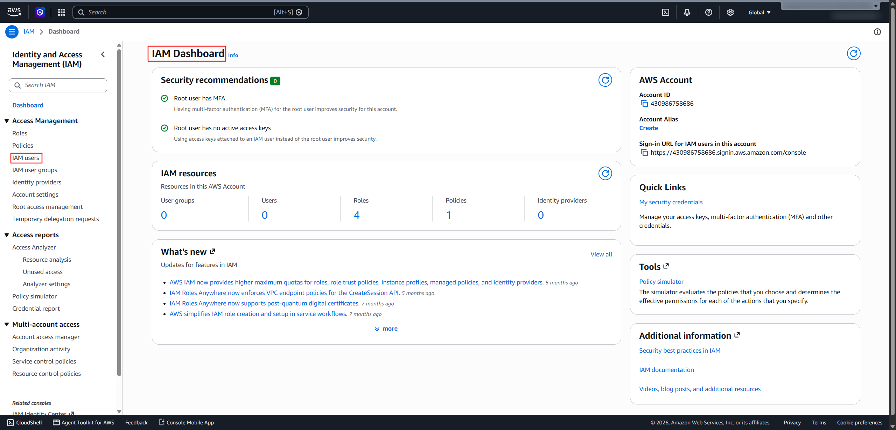

### 5.2 Create the lab IAM user

The user created for the lab is:

`ec2-nginx-lab-user`

The user is intended for AWS CLI access from WSL Ubuntu. Console sign-in
was not enabled for this user.

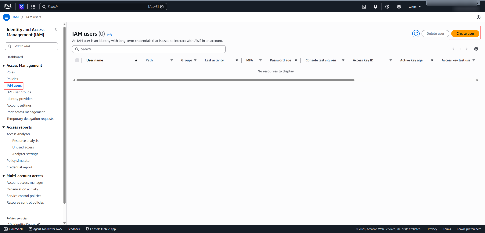

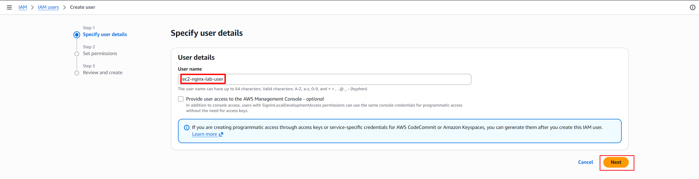

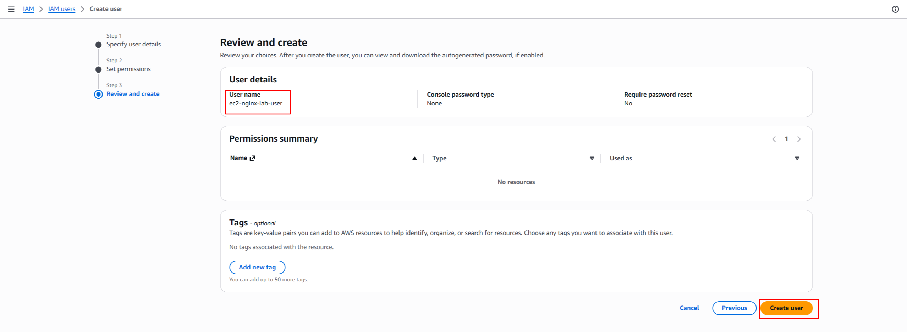

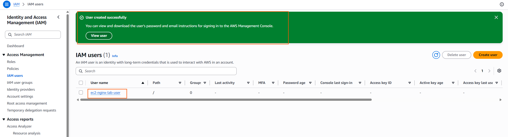

### 5.3 Add the user to the group

The user `ec2-nginx-lab-user` was added to `EC2-NGINX-Lab-Group`.

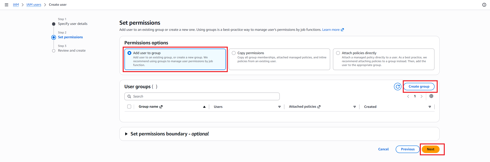


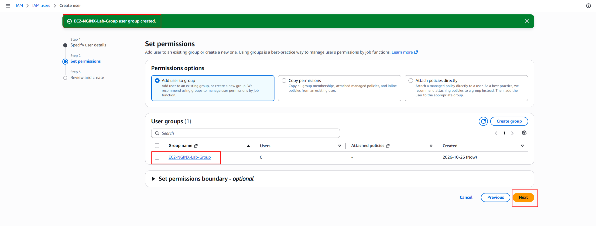

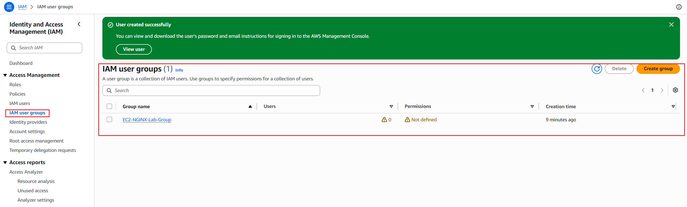


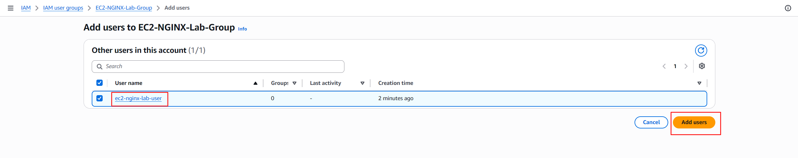


### 5.4 Create and attach the discovery policy

The inline policy is named:

`EC2-NGINX-Lab-Discovery`

Its purpose is to allow selected **read-only discovery operations**. It
is not intended to authorize instance creation, security-group
modification, key-pair creation, or other deployment changes.

The policy's action list was expanded as additional read-only checks
returned `UnauthorizedOperation`. The current intended action list is:

```json
{
  "Version": "2012-10-17",
  "Statement": [
    {
      "Sid": "EC2ReadOnlyDiscovery",
      "Effect": "Allow",
      "Action": [
        "ec2:DescribeAvailabilityZones",
        "ec2:DescribeImages",
        "ec2:DescribeInstanceTypes",
        "ec2:DescribeInstances",
        "ec2:DescribeInternetGateways",
        "ec2:DescribeKeyPairs",
        "ec2:DescribeNetworkAcls",
        "ec2:DescribeRegions",
        "ec2:DescribeRouteTables",
        "ec2:DescribeSecurityGroups",
        "ec2:DescribeSubnets",
        "ec2:DescribeVpcs"
      ],
      "Resource": "*"
    }
  ]
}
```


> This is the policy content intended to reflect the permissions added
> during discovery. Verify the saved policy in the AWS Console if you
> need to confirm its current live contents.

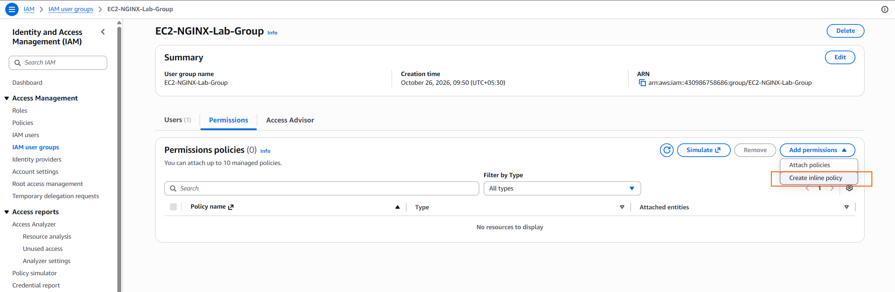


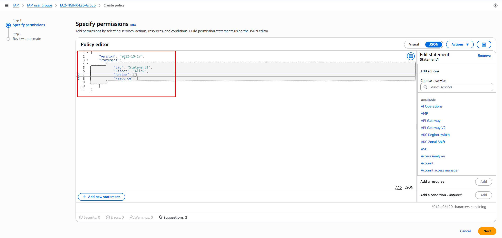


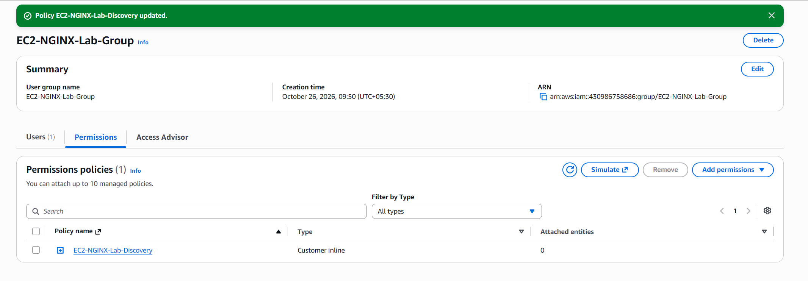

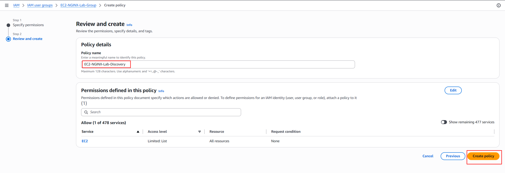


#### Policy explanation

| Policy element   | Meaning                                                                          |
|:-----------------|:---------------------------------------------------------------------------------|
| `Version`        | IAM policy language version                                                      |
| `Statement`      | Contains the permission statement                                                |
| `Sid`            | A descriptive identifier for the statement                                       |
| `Effect: Allow`  | Allows the listed actions, subject to other applicable policies and restrictions |
| `Action`         | Lists the permitted EC2 discovery operations                                     |
| `Resource: "\*"` | Uses all-resource scope for these supported describe actions                     |

The policy is for discovery only. The permissions required to create or
modify deployment resources must be planned separately and granted only
when needed.

------------------------------------------------------------------------

## 6. Configure and verify AWS CLI

### 6.1 Configure a named profile

Run in WSL Ubuntu:

``` bash

aws configure --profile ec2-nginx-lab
```

Enter the access key and secret access key for the lab identity when
prompted. Use the following non-secret configuration values:

``` text

Default region name: us-west-2

Default output format: json
```

Do not put actual credential values into this README.

The named profile keeps the lab's configuration separate from the
default AWS CLI profile.


### 6.2 Verify the active AWS identity

Run:

``` bash

aws sts get-caller-identity --profile ec2-nginx-lab
```

The command succeeded and identified the caller as the lab IAM user. The
account number and user ID are intentionally not reproduced here.

The ARN had this form:


> arn:aws:iam::\<AWS_ACCOUNT_ID>:user/ec2-nginx-lab-user


**Result: Passed.** AWS authentication works with the `ec2-nginx-lab`
profile.

### 6.3 Verify profile configuration

Run:

``` bash

aws configure list --profile ec2-nginx-lab
```

The observed configuration showed:

-   Profile: `ec2-nginx-lab`
-   Access key source: shared credentials file
-   Secret key source: shared credentials file
-   Region: `us-west-2`, read from the AWS CLI configuration file

The credential values should remain masked in any screenshot or shared
output.

**Result: Passed.** The expected profile and region were confirmed.

### 6.4 Create access keys securely

The screenshots document the CLI access-key creation flow. Access keys
are credentials, not ordinary configuration data. Store them securely,
do not commit them to Git, and never include their values in
screenshots.


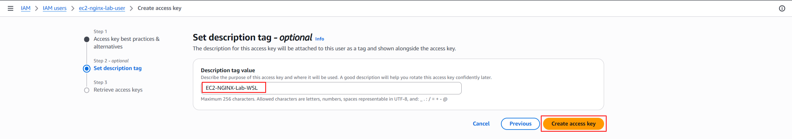


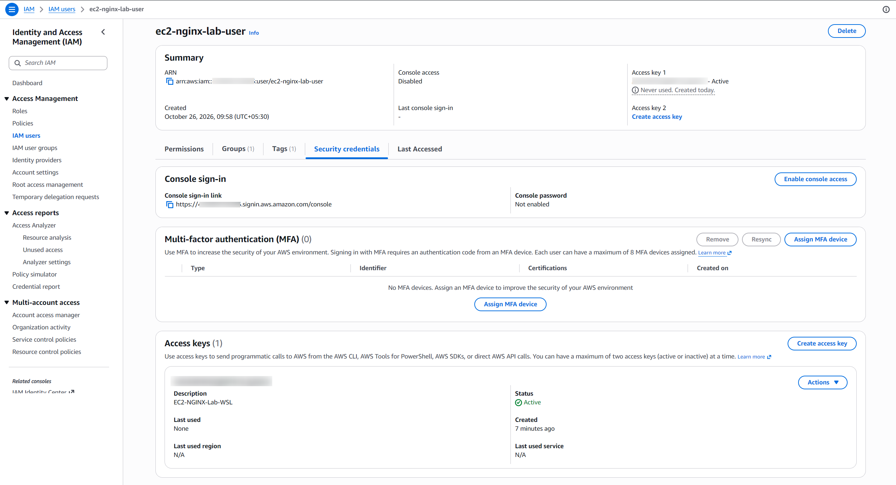

------------------------------------------------------------------------

## 7. Verify existing EC2 resources

All commands in this section are read-only.

### 7.1 Check existing instances

``` bash

aws ec2 describe-instances --region us-west-2 --profile ec2-nginx-lab --output table
```

The command succeeded and returned an empty table---no instances were
returned for this identity and region.

**Result: Passed.** The identity can call `ec2:DescribeInstances`; no
existing instances were returned by this query.

### 7.2 Check existing key pairs

``` bash

aws ec2 describe-key-pairs --region us-west-2 --profile ec2-nginx-lab --output table
```

The command succeeded and returned an empty table---no EC2 key pairs
were returned in this region.

**Result: Passed.** The identity can call `ec2:DescribeKeyPairs`. A key
pair has not been created for this lab.

------------------------------------------------------------------------

## 8. Inspect the default VPC and subnets

### 8.1 Discover the VPC

A VPC is a logically isolated network in AWS. EC2 instances launch into
a subnet within a VPC.

Run:

``` bash

aws ec2 describe-vpcs --region us-west-2 --profile ec2-nginx-lab --query "Vpcs[].{VpcId:VpcId,State:State,IsDefault:IsDefault,CidrBlock:CidrBlock}" --output table
```

The command returned this VPC:

| Field       | Observed value          |
|:------------|:------------------------|
| VPC ID      | `vpc-0307ce67a0df86851` |
| State       | `available`             |
| Default VPC | `True`                  |
| IPv4 CIDR   | `172.31.0.0/16`         |

The CIDR is the VPC's private IPv4 address range; it is not the public
IP address of an EC2 instance.


**Result: Passed.** An available default VPC was found. No VPC was
created or modified.

### 8.2 Discover subnets

Run:

``` bash
aws ec2 describe-subnets --region us-west-2 --profile ec2-nginx-lab --filters "Name=vpc-id,Values=vpc-0307ce67a0df86851" --query "Subnets[].{SubnetId:SubnetId,AZ:AvailabilityZone,State:State,DefaultForAZ:DefaultForAz,PublicIP:MapPublicIpOnLaunch,CIDR:CidrBlock}" --output table

```


Four available default subnets were returned:

| Availability Zone | Subnet ID                  | CIDR             | Default subnet for AZ | Auto-assign public IPv4 |
|:------------------|:---------------------------|:-----------------|:----------------------|:------------------------|
| `us-west-2a`      | `subnet-02ecdd68edfbf7326` | `172.31.32.0/20` | Yes                   | Yes                     |
| `us-west-2c`      | `subnet-003413e14c2375f32` | `172.31.0.0/20`  | Yes                   | Yes                     |
| `us-west-2d`      | `subnet-0ce894c858eab9c2e` | `172.31.48.0/20` | Yes                   | Yes                     |
| `us-west-2b`      | `subnet-006fde08c5f4e902c` | `172.31.16.0/20` | Yes                   | Yes                     |

`MapPublicIpOnLaunch: True` means the subnet is configured to assign
public IPv4 addresses to instances by default, unless overridden at
launch. It does not, by itself, guarantee internet connectivity.


**Result: Passed.** Four available default subnets were discovered. No
subnet was created or modified.

### 8.3 Verify the chosen subnet's public-IP setting

For a closer inspection of the subnet in `us-west-2a`, run:

``` bash

aws ec2 describe-subnets --region us-west-2 --profile ec2-nginx-lab --subnet-ids subnet-02ecdd68edfbf7326 --query "Subnets[].{SubnetId:SubnetId,AZ:AvailabilityZone,Cidr:CidrBlock,State:State,MapPublicIpOnLaunch:MapPublicIpOnLaunch,VpcId:VpcId}" --output table
```

Observed values:

-   Subnet: `subnet-02ecdd68edfbf7326`

-   Availability Zone: `us-west-2a`

-   CIDR: `172.31.32.0/20`

-   State: `available`

-   `MapPublicIpOnLaunch`: `True`

-   VPC: `vpc-0307ce67a0df86851`


------------------------------------------------------------------------

## 9. Inspect routing and Internet Gateway

### 9.1 Discover route tables

Run:

``` bash
aws ec2 describe-route-tables --region us-west-2 --profile ec2-nginx-lab --filters "Name=vpc-id,Values=vpc-0307ce67a0df86851" --query "RouteTables[].{RouteTableId:RouteTableId,Associations:Associations[].SubnetId,Routes:Routes[].{Destination:DestinationCidrBlock,Gateway:GatewayId,State:State}}" --output json
```

The discovered route table was `rtb-0bc5c0a06e2d2b2c0`. Its routes were:

| Destination     | Target                  | State    | Meaning                                        |
|:----------------|:------------------------|:---------|:-----------------------------------------------|
| `172.31.0.0/16` | `local`                 | `active` | Route for traffic within the VPC               |
| `0.0.0.0/0`     | `igw-0b25879d76a25f195` | `active` | Default IPv4 route toward the Internet Gateway |

The route table initially showed no explicit subnet associations.


### 9.2 Verify the route table's main association

Run:

``` bash
aws ec2 describe-route-tables --region us-west-2 --profile ec2-nginx-lab --route-table-ids rtb-0bc5c0a06e2d2b2c0 --query "RouteTables[].{RouteTableId:RouteTableId,MainAssociations:Associations[?Main==\`true\`].Main,SubnetAssociations:Associations[?SubnetId!=null].SubnetId}" --output json

```

The result confirmed:

-   Route table: `rtb-0bc5c0a06e2d2b2c0`

-   `Main: true`

-   No explicit subnet associations listed

**Note about the query:** The output key named `VpcId` in this command
was mistakenly populated from `RouteTableId`. Therefore, that displayed
field is not the VPC ID. The main-association result itself confirms
that this is the main route table. The actual VPC ID was independently
confirmed as `vpc-0307ce67a0df86851`.


Subnets without explicit route-table associations use the VPC's main
route table.

### 9.3 Verify the Internet Gateway attachment

Run:

``` bash

aws ec2 describe-internet-gateways --region us-west-2 --profile ec2-nginx-lab --internet-gateway-ids igw-0b25879d76a25f195 --query "InternetGateways[].{InternetGatewayId:InternetGatewayId,Attachments:Attachments[].{VpcId:VpcId,State:State}}" --output json
```

The command confirmed that:

-   Internet Gateway: `igw-0b25879d76a25f195`

-   Attached VPC: `vpc-0307ce67a0df86851`

-   Attachment state: `available`


**Networking interpretation:** An active default route and an attached
Internet Gateway are important prerequisites for public IPv4 internet
routing. They do not alone guarantee that a particular instance will be
reachable. Public-IP assignment, security groups, network ACLs, host
configuration, and other conditions still apply.

------------------------------------------------------------------------

## 10. Inspect the network ACL

A network ACL (NACL) is a subnet-level traffic filter. Unlike security
groups, network ACLs are **stateless**, so inbound and outbound traffic
must be considered separately.

Run:

``` bash

aws ec2 describe-network-acls --region us-west-2 --profile ec2-nginx-lab --filters "Name=vpc-id,Values=vpc-0307ce67a0df86851" --query "NetworkAcls[].{NetworkAclId:NetworkAclId,IsDefault:IsDefault,Associations:Associations[].SubnetId,Entries:Entries[].{RuleNumber:RuleNumber,Protocol:Protocol,RuleAction:RuleAction,Egress:Egress,CidrBlock:CidrBlock,PortRange:PortRange}}" --output json
```

The command returned:

-   Network ACL: `acl-0d28ab2e0e6e79bf6`

-   Default ACL: `true`

-   Associated subnets: all four subnets discovered above

-   Rule `100`: allow all protocols for IPv4 `0.0.0.0/0`, for both
    inbound (`Egress: false`) and outbound (`Egress: true`)

-   Rule `32767`: deny-all catch-all, for both directions

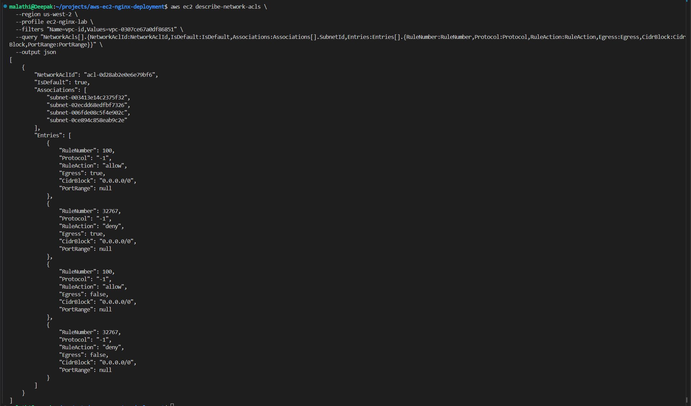

The rule numbered `100` is evaluated before the catch-all rule `32767`.
Since the allow rule matches all IPv4 traffic, the later deny rule does
not override it.

**Security note:** `0.0.0.0/0` means all IPv4 addresses. We should not
rely on the default NACL to restrict access to the Nginx instance. The
instance's security group should allow only the intended inbound
traffic.

------------------------------------------------------------------------

## 11. Check the AMI and instance type

### 11.1 Discover Amazon Linux 2023 AMIs

Run:

``` bash
aws ec2 describe-images --region us-west-2 --profile ec2-nginx-lab --owners amazon --filters "Name=name,Values=al2023-ami-2023.*-x86_64" "Name=state,Values=available" "Name=architecture,Values=x86_64" "Name=root-device-type,Values=ebs" --query "Images | sort_by(@, &CreationDate)[-5:].[*].{ImageId:ImageId,Name:Name,CreationDate:CreationDate,Architecture:Architecture}" --output json
```

Five available Amazon Linux 2023 AMIs were returned. Examples from the
observed output include:

| AMI ID                  | Image name                                         | Architecture |
|:------------------------|:---------------------------------------------------|:-------------|
| `ami-0e0fcdc77c6355731` | `al2023-ami-2023.12.20261021.0-kernel-6.18-x86_64` | `x86_64`     |
| `ami-0ce59d8f4219233f7` | `al2023-ami-2023.12.20261021.0-kernel-6.12-x86_64` | `x86_64`     |
| `ami-0f4093d08169978db` | `al2023-ami-2023.12.20261026.1-kernel-6.12-x86_64` | `x86_64`     |
| `ami-074462d12abec759f` | `al2023-ami-2023.12.20261026.1-kernel-6.1-x86_64`  | `x86_64`     |
| `ami-0829b74b2a8c619b7` | `al2023-ami-2023.12.20261026.1-kernel-6.18-x86_64` | `x86_64`     |

The image query returned available images owned by Amazon, with x86-64
architecture and EBS root devices. AMI IDs are region-specific, and the
latest available image may change over time.


**Status:** AMI discovery succeeded. The final AMI selection should be
confirmed again immediately before launching the instance.

### 11.2 Check `t3.micro` specifications

Run:

``` bash

aws ec2 describe-instance-types --region us-west-2 --profile ec2-nginx-lab --instance-types t3.micro --query "InstanceTypes[].{InstanceType:InstanceType,Architectures:ProcessorInfo.SupportedArchitectures,vCPUs:VCpuInfo.DefaultVCpus,MemoryMiB:MemoryInfo.SizeInMiB}" --output table
```

The output confirmed:

| Property      | Result             |
|:--------------|:-------------------|
| Instance type | `t3.micro`         |
| Architecture  | `x86_64`           |
| vCPUs         | `2`                |
| Memory        | `1024 MiB` (1 GiB) |


The `x86_64` instance architecture matches the discovered x86-64 AMI
candidates.

**Important:** This command confirms the instance type's specifications.
It does not confirm account quota, Availability Zone capacity, launch
permissions, or cost eligibility. Check current AWS pricing and account
eligibility before provisioning; do not assume the instance is free.

------------------------------------------------------------------------

## 12. Check public-IP behavior

The subnet `subnet-02ecdd68edfbf7326` in `us-west-2a` returned
`MapPublicIpOnLaunch: true`.

This setting means automatic public IPv4 assignment is enabled for
launches in that subnet unless the launch configuration overrides it. It
does not prove that a running application will be reachable.

The network prerequisites to consider together are:

1\. The subnet's public-IP assignment behavior.

2\. The main route table's default route to the Internet Gateway.

3\. The Internet Gateway's attachment to the VPC.

4\. Security-group inbound and outbound rules.

5\. Network ACL inbound and outbound rules.

6\. The instance's operating system and application configuration.

------------------------------------------------------------------------

## 13. Inspect the existing security group

### 13.1 List security groups in the VPC

Run:

``` bash

aws ec2 describe-security-groups --region us-west-2 --profile ec2-nginx-lab --filters "Name=vpc-id,Values=vpc-0307ce67a0df86851" --query "SecurityGroups[].{GroupId:GroupId,GroupName:GroupName,Description:Description,VpcId:VpcId}" --output table
```

Only the default security group was returned:

| Field | Value |
|---|---|
| Group ID | `sg-03b944b8175124bda` |
| Group name | `default` |
| Description | `default VPC security group` |
| VPC | `vpc-0307ce67a0df86851` |


### 13.2 Inspect the default security group's inbound rules

Run:

``` bash

aws ec2 describe-security-groups --region us-west-2 --profile ec2-nginx-lab --group-ids sg-03b944b8175124bda --query "SecurityGroups[].{GroupId:GroupId,Inbound:IpPermissions}" --output json
```

The observed inbound rule allowed all protocols from resources
associated with the **same security group**. The output did not show an
IPv4 CIDR or IPv6 CIDR as an inbound source.


This is not the same as allowing inbound access from the whole internet.
The default security group is not the intended public-web access policy
for this lab.

### 13.3 Inspect the default security group's outbound rules

Run:

``` bash

aws ec2 describe-security-groups --region us-west-2 --profile ec2-nginx-lab --group-ids sg-03b944b8175124bda --query "SecurityGroups[].{GroupId:GroupId,Outbound:IpPermissionsEgress}" --output json
```

The observed outbound rule allowed all protocols to IPv4 destination
`0.0.0.0/0`.


**Important:** An outbound security-group rule is not proof of internet
connectivity. Routing, gateway attachment, public addressing, NACLs, and
host configuration also matter.

### 13.4 Decide on the lab security group

Before deployment, create or select a **dedicated security group** for
the Nginx instance, using an authorized identity and a deliberate
inbound policy. A typical public HTTP demonstration needs inbound TCP
port `80` from the intended audience. SSH access on TCP port `22`, if
needed, should be restricted to the user's trusted IP address or
replaced with an appropriate managed access method. HTTPS on TCP port
`443` should be opened only if TLS is configured for the lab.

Do not use a broad inbound rule such as all protocols from `0.0.0.0/0`.


------------------------------------------------------------------------

## 14. Verified findings (pre-deployment discovery)

The following table records what was found during the initial read-only
discovery phase. Some rows are historical snapshots from before the lab
resources were created; they are not the current resource inventory.

| Check                    | Result at discovery time                                                                                                             |
|:-------------------------|:-------------------------------------------------------------------------------------------------------------------------------------|
| AWS CLI named profile    | `ec2-nginx-lab` configured                                                                                                           |
| AWS identity             | Verified with STS                                                                                                                    |
| Region                   | `us-west-2` (Oregon)                                                                                                                 |
| Existing EC2 instances   | None returned before this lab's launch                                                                                               |
| Existing EC2 key pairs   | None returned before this lab's key pair was created                                                                                 |
| Default VPC              | `vpc-0307ce67a0df86851`, CIDR `172.31.0.0/16`                                                                                        |
| Selected subnet          | `subnet-02ecdd68edfbf7326`, `us-west-2a`, `172.31.32.0/20`                                                                           |
| Main route table         | `rtb-0bc5c0a06e2d2b2c0`, active default route to the Internet Gateway                                                                |
| Internet Gateway         | `igw-0b25879d76a25f195`, attached to the VPC                                                                                         |
| Network ACL              | Default ACL; IPv4 allow entries in both directions                                                                                   |
| AMI                      | Amazon Linux 2023 x86-64 image verified available before launch                                                                      |
| Instance type            | `t3.micro`, x86-64, 2 vCPUs, 1 GiB memory                                                                                            |
| Dedicated security group | Created for the lab; HTTP 80 public, SSH 22 restricted to the current public IP at setup time                                        |
| Launch permission check  | IAM Policy Simulator showed `RunInstances` allowed for subnet, image, instance, network-interface, and security-group resource types |

## 15. Security and cost notes

-   Never commit AWS access keys, secret access keys, session tokens, or
    private SSH keys.

-   The SSH inbound rule was restricted to the public IP observed during
    setup. If your IP changes, update the rule carefully before SSH; do
    not open port 22 to `0.0.0.0/0`.

-   HTTP port 80 is intentionally open to the internet for this demo. Do
    not send sensitive data over plain HTTP.

-   The instance uses an 8 GiB `gp3` EBS root volume with
    `DeleteOnTermination=true`.

-   EC2 compute, EBS storage, public IPv4, data transfer, and other
    resources may incur charges. Stopping an instance generally stops
    compute charges, but retained storage and public IPv4 may still be
    billed. Confirm current pricing and account eligibility.

-   When the lab is complete, preserve screenshots and notes, then
    terminate the instance if you no longer need it. Verify the result
    in the AWS console or with `describe-instances`.

## 16. Troubleshooting notes

### `UnauthorizedOperation`

Example:

``` text

You are not authorized to perform: ec2:DescribeNetworkAcls
```

**Meaning:** The IAM identity does not have an applicable allow for the
requested action, or another policy restriction applies.

**Resolution used in this lab:** Add the specific missing read-only
`ec2:Describe...` action to the existing discovery policy, if
authorized, then retry the same read-only command. If you cannot edit
IAM policies, request help from an authorized administrator. Do not
grant yourself broader permissions to bypass the error.

### Empty output from `describe-instances` or `describe-key-pairs`

An empty result can mean no matching resources were returned for the
identity and Region. It is not, by itself, evidence of an error.

### An Internet Gateway route does not guarantee reachability

Check public-IP assignment, the route table, gateway attachment,
security groups, NACLs, host firewall, and whether the service is
listening on the intended port.


### Before repeating this deployment: replace dynamic values

The resource IDs, IP addresses, AMI IDs, and other environment-specific values in this README are examples from my AWS lab execution. They are retained as historical evidence of the deployment.

**Do not assume these values will be the same in your AWS account.** Before repeating the lab, discover the current values and replace the corresponding placeholders in the commands.

| Value | Example from my lab | What you should do |
|---|---|---|
| AWS Region | `us-west-2` | Replace with your selected AWS Region and use it consistently. |
| AWS CLI profile | `ec2-nginx-lab` | Replace with your configured AWS CLI profile name. |
| AWS account ID | Not displayed | Use your own account; do not copy another account's ID. |
| VPC ID | `vpc-0307ce67a0df86851` | Discover the VPC ID in your selected Region. |
| Subnet ID | `subnet-02ecdd68edfbf7326` | Select an available subnet in your chosen VPC and Availability Zone. |
| AMI ID | `ami-0f4093d08169978db` | Discover a currently available Amazon Linux 2023 AMI in your Region. |
| Instance type | `t3.micro` | Confirm availability, architecture, account eligibility, and pricing. |
| Key pair name | `ec2-nginx-lab-key` | Use an existing key pair or create one in the selected Region. |
| Private key path | `~/.ssh/ec2-nginx-lab-key.pem` | Replace with the actual path to your private key file. |
| Security Group ID | `sg-01a2155926d1b3e19` | Use the ID returned when you create your own dedicated security group. |
| SSH source IP | My public IP at setup time | Discover your current public IP and use it with `/32`. |
| EC2 instance ID | `i-0ea3759cfcb87faed` | Use the instance ID returned by your own launch command. |
| Public IPv4 address | `35.92.109.120` | Retrieve the current public IP of your running instance. |
| Private IPv4 address | `172.31.46.91` | Retrieve the private IP assigned to your instance. |
| Website URL | `http://35.92.109.120` | Replace with your instance's current public IPv4 address. |

**Important distinction:**

- Historical values are retained to document what I actually used and verified.
- Dynamic values must be rediscovered when you repeat the lab.
- Resource IDs are not interchangeable. For example, a Security Group ID from another VPC cannot simply be reused.
- Public IPv4 addresses can change. Always retrieve the current address before testing HTTP or SSH.
- AMI IDs are Region-specific and can change as new images are released.
- A resource that was deleted or terminated must be recreated before it can be used again.

The commands below show my actual lab values as examples. Replace them with your own discovered values wherever required.

### Quick reference: discover your current AWS values

Run these commands before deployment. Replace the Region and profile if yours are different.

**1. Verify AWS identity**

```bash
aws sts get-caller-identity --profile ec2-nginx-lab
```

**2. Find your VPC**

```bash
aws ec2 describe-vpcs --region us-west-2 --profile ec2-nginx-lab --query "Vpcs[].{VpcId:VpcId,Default:IsDefault,CIDR:CidrBlock,State:State}" --output table
```

**3. Find available subnets**

```bash
aws ec2 describe-subnets --region us-west-2 --profile ec2-nginx-lab --query "Subnets[].{SubnetId:SubnetId,AZ:AvailabilityZone,VpcId:VpcId,CIDR:CidrBlock,State:State,PublicIP:MapPublicIpOnLaunch}" --output table
```

**4. Find the latest available Amazon Linux 2023 x86-64 AMI**

```bash
aws ec2 describe-images --region us-west-2 --profile ec2-nginx-lab --owners amazon --filters "Name=name,Values=al2023-ami-2023.*-x86_64" "Name=state,Values=available" "Name=architecture,Values=x86_64" "Name=root-device-type,Values=ebs" --query "Images | sort_by(@, &CreationDate)[-1].{ImageId:ImageId,Name:Name,CreationDate:CreationDate}" --output table
```

**5. Find your current public IP for SSH access**

```bash
curl -4 https://checkip.amazonaws.com
```

Use the returned address followed by `/32` in the SSH inbound rule.

**6. Find existing EC2 key pairs**

```bash
aws ec2 describe-key-pairs --region us-west-2 --profile ec2-nginx-lab --query "KeyPairs[].{Name:KeyName,KeyPairId:KeyPairId}" --output table
```

**7. Find existing security groups**

```bash
aws ec2 describe-security-groups --region us-west-2 --profile ec2-nginx-lab --filters "Name=vpc-id,Values=vpc-0307ce67a0df86851" --query "SecurityGroups[].{GroupId:GroupId,GroupName:GroupName,VpcId:VpcId}" --output table
```

---

## 17. Before repeating this deployment

The resource IDs, IP addresses, AMI IDs, and other environment-specific values in this README are examples from my AWS lab execution. They are retained as historical evidence of the deployment.

**Do not assume these values will be the same in your AWS account.** Before repeating the lab, discover the current values and replace the corresponding placeholders in the commands.

### 17.1 Understand the values you need

| Value | Example from my lab | What you should do |
|:---|:---|:---|
| AWS Region | `us-west-2` | Use your selected AWS Region consistently. |
| AWS CLI profile | `ec2-nginx-lab` | Use your configured AWS CLI profile name. |
| VPC ID | `vpc-0307ce67a0df86851` | Discover the VPC ID in your selected Region. |
| Subnet ID | `subnet-02ecdd68edfbf7326` | Select a subnet in your chosen VPC and Availability Zone. |
| AMI ID | `ami-0f4093d08169978db` | Discover a currently available Amazon Linux 2023 AMI. |
| Instance type | `t3.micro` | Confirm availability, architecture, account eligibility, and pricing. |
| Key pair name | `ec2-nginx-lab-key` | Use an existing key pair or create one in the selected Region. |
| Private key path | `~/.ssh/ec2-nginx-lab-key.pem` | Confirm the matching private key exists locally. |
| Security Group ID | `sg-01a2155926d1b3e19` | Create your own dedicated security group and use its returned ID. |
| SSH source IP | Public IP at setup time | Discover your current public IP and use it with `/32`. |

**Important distinctions:**

- Historical values document what I actually used and verified.
- Dynamic values must be rediscovered when you repeat the lab.
- Resource IDs are not interchangeable. For example, a security group from another VPC cannot simply be reused.
- AMI IDs are Region-specific and can change as new images are released.
- A resource that was deleted or terminated must be recreated before it can be used again.
- Do not use the old security group ID `sg-01a2155926d1b3e19`; it was deleted during the original lab cleanup.

### 17.2 Quick reference: discover your current AWS values

Run these commands before deployment. Replace the Region and profile if yours are different.

**1. Verify AWS identity**

```bash
aws sts get-caller-identity --profile ec2-nginx-lab
```

Expected result: Your AWS account and the IAM identity associated with the configured profile.

**2. Find your VPC**

```bash
aws ec2 describe-vpcs --region us-west-2 --profile ec2-nginx-lab --query "Vpcs[].{VpcId:VpcId,State:State,IsDefault:IsDefault,CidrBlock:CidrBlock}" --output table
```

Expected result: A list of VPCs, their IDs, CIDR blocks, and states.

**3. Find available subnets**

```bash
aws ec2 describe-subnets --region us-west-2 --profile ec2-nginx-lab --query "Subnets[].{SubnetId:SubnetId,AZ:AvailabilityZone,VpcId:VpcId,CIDR:CidrBlock,State:State,PublicIP:MapPublicIpOnLaunch}" --output table
```

Expected result: Subnet IDs, Availability Zones, associated VPC IDs, CIDR blocks, and public-IP mapping settings.

Choose a subnet belonging to your selected VPC. For this public web-server demonstration, also confirm that its route table has a route to an Internet Gateway.

**4. Find the latest available Amazon Linux 2023 x86-64 AMI**

```bash
aws ec2 describe-images --region us-west-2 --profile ec2-nginx-lab --owners amazon --filters "Name=name,Values=al2023-ami-2023.*-x86_64" "Name=state,Values=available" "Name=architecture,Values=x86_64" "Name=root-device-type,Values=ebs" --query "Images | sort_by(@, &CreationDate)[-1].{ImageId:ImageId,Name:Name,CreationDate:CreationDate}" --output table
```

Expected result: The latest matching available Amazon Linux 2023 AMI. Copy the returned AMI ID for Section 18.

**5. Find your current public IP for SSH access**

```bash
curl -4 https://checkip.amazonaws.com
```

Expected result: Your current public IPv4 address. Use this address followed by `/32` in the SSH inbound rule.

**6. Find existing EC2 key pairs**

```bash
aws ec2 describe-key-pairs --region us-west-2 --profile ec2-nginx-lab --query "KeyPairs[].{Name:KeyName,KeyPairId:KeyPairId}" --output table
```

Expected result: A list of key pairs available in the selected Region.

**7. Find existing security groups in your selected VPC**

Replace `<VPC_ID>` with the VPC ID discovered in Step 2.

```bash
aws ec2 describe-security-groups --region us-west-2 --profile ec2-nginx-lab --filters "Name=vpc-id,Values=<VPC_ID>" --query "SecurityGroups[].{GroupId:GroupId,GroupName:GroupName,VpcId:VpcId}" --output table
```

Expected result: A list of security groups belonging to the selected VPC.

**Section 17 completion checklist**

Before moving to Section 18, confirm that you have:

- Verified your AWS identity.
- Identified your VPC and selected subnet.
- Discovered a current Amazon Linux 2023 AMI.
- Confirmed your current public IP address.
- Checked the available EC2 key pairs.
- Checked the existing security groups in your selected VPC.

No EC2 instance is launched in Section 17.

---

## 18. Launch the EC2 instance and install NGINX

The original deployment was performed from WSL Ubuntu using the named AWS CLI profile. It created one Amazon Linux 2023 instance, attached a dedicated security group and an existing key pair, requested a public IPv4 address, configured an 8 GiB `gp3` root volume, and used EC2 user data to install and start NGINX.

> **Important deployment order:** Complete the steps in this section in order:
>
> 1. Confirm the VPC, subnet, AMI, and current SSH source IP.
> 2. Create the dedicated security group.
> 3. Add and verify the inbound rules.
> 4. Create or confirm the EC2 key pair and local private key.
> 5. Confirm the launch values.
> 6. Launch the EC2 instance.
>
> Do not run the launch command before the security group and key pair are ready.

### 18.1 Create and configure the dedicated security group

A security group acts as a virtual firewall for an EC2 instance.

For this public NGINX demonstration, we need two inbound rules:

| Port | Protocol | Source | Purpose |
|:---:|:---|:---|:---|
| 22 | TCP | Your public IP `/32` | SSH administration |
| 80 | TCP | `0.0.0.0/0` | Public HTTP website |

**Step 1: Confirm the VPC ID**

Use the VPC ID discovered in Section 17. The original lab used:

```text
vpc-0307ce67a0df86851
```

For a new environment, replace this with your own VPC ID.

**Step 2: Create or reuse the dedicated security group**

First, try creating the security group:

```bash
aws ec2 create-security-group --group-name ec2-nginx-lab-sg --description "Security group for EC2 NGINX web application" --vpc-id vpc-0307ce67a0df86851 --region us-west-2 --profile ec2-nginx-lab
```

The output returns a `GroupId`. Copy this value.

**Important:** If AWS returns `InvalidGroup.Duplicate`, the security group already exists in the selected VPC. Do not create another group or delete the existing one. Retrieve its details using:

```bash
aws ec2 describe-security-groups --region us-west-2 --profile ec2-nginx-lab --filters "Name=group-name,Values=ec2-nginx-lab-sg" "Name=vpc-id,Values=vpc-0307ce67a0df86851" --query "SecurityGroups[].{GroupId:GroupId,GroupName:GroupName,VpcId:VpcId,InboundRules:IpPermissions}" --output json
```

Use the returned `GroupId` in the following steps.

**Verified result from this lab:**

- Security group name: `ec2-nginx-lab-sg`
- Security group ID: `sg-0305c3222ac971de1`
- VPC ID: `vpc-0307ce67a0df86851`
- Initial inbound rules: None

For a new environment, use the Group ID returned by your own AWS command instead of the historical value above.

**Step 3: Find your current public IP**

```bash
curl -4 https://checkip.amazonaws.com
```

Use the returned IPv4 address in the next command. Add `/32` to restrict SSH access to that address.

For example, if the command returns `203.0.113.10`, the SSH source CIDR would be `203.0.113.10/32`. This is only an example address; use your actual result.

**Step 4: Add both inbound rules**

Replace:
- `<SECURITY_GROUP_ID>` with the Group ID obtained in Step 2.
- `<YOUR_PUBLIC_IP>` with the public IPv4 address returned in Step 3.

```bash
aws ec2 authorize-security-group-ingress --group-id <SECURITY_GROUP_ID> --ip-permissions '[{"IpProtocol":"tcp","FromPort":22,"ToPort":22,"IpRanges":[{"CidrIp":"<YOUR_PUBLIC_IP>/32","Description":"SSH access from my public IP"}]},{"IpProtocol":"tcp","FromPort":80,"ToPort":80,"IpRanges":[{"CidrIp":"0.0.0.0/0","Description":"Public HTTP access"}]}]' --region us-west-2 --profile ec2-nginx-lab
```

**Note:** If these rules already exist, do not add them again. Inspect the current rules and add only missing rules.

**Step 5: Verify the inbound rules**

```bash
aws ec2 describe-security-groups --group-ids <SECURITY_GROUP_ID> --region us-west-2 --profile ec2-nginx-lab --query "SecurityGroups[0].IpPermissions" --output table
```

Confirm that TCP ports `22` and `80` are present with the intended sources.

**Important:** Use the security group ID confirmed in Step 2 in the EC2 launch command. Do not use the old security group ID `sg-01a2155926d1b3e19`; it belonged to the original lab and was deleted during cleanup.

### 18.2 Create or confirm the EC2 key pair

EC2 uses a key pair for SSH authentication. The private key is downloaded when the key pair is created. AWS does not provide a way to download that same private key again later.

The original lab used:

- Key pair name: `ec2-nginx-lab-key`
- Local private key path: `~/.ssh/ec2-nginx-lab-key.pem`

**Step 1: Check whether the key pair already exists**

```bash
aws ec2 describe-key-pairs --region us-west-2 --profile ec2-nginx-lab --key-names ec2-nginx-lab-key --output table
```

If it exists and you still have its matching private key file, you can use it. Do not create another key pair with the same name.

**Verified result from this lab:**

- Key pair name: `ec2-nginx-lab-key`
- Key pair ID: `key-0f875d77750209cca`
- Key type: RSA
- Creation date: `2026-10-26`

**Step 2: If it does not exist, create a new key pair**

First, create the local SSH directory and restrict its permissions:

```bash
mkdir -p ~/.ssh && chmod 700 ~/.ssh
```

Then create the key pair and save the returned private key locally:

```bash
aws ec2 create-key-pair --key-name ec2-nginx-lab-key --key-type rsa --key-format pem --region us-west-2 --profile ec2-nginx-lab --query 'KeyMaterial' --output text > ~/.ssh/ec2-nginx-lab-key.pem
```

Restrict the private-key file permissions:

```bash
chmod 400 ~/.ssh/ec2-nginx-lab-key.pem
```

Verify the file exists:

```bash
ls -l ~/.ssh/ec2-nginx-lab-key.pem
```

The file should be readable only by its owner. Do not upload this private key to GitHub or include it in screenshots.

**Step 3: Verify the existing local private key**

If the key pair already exists in AWS, verify that the corresponding private key is available locally:

```bash
ls -l ~/.ssh/ec2-nginx-lab-key.pem
```

Verify that the private key is valid and readable:

```bash
ssh-keygen -y -f ~/.ssh/ec2-nginx-lab-key.pem
```

A successful result displays a public key beginning with `ssh-rsa`.

**Verified local key file from this lab:**

- File path: `/home/malathi/.ssh/ec2-nginx-lab-key.pem`
- Owner: `malathi`
- File permissions: `400`
- File size: `1679 bytes`
- Private key verification: Successful

The existing private key was successfully verified using `ssh-keygen -y`.

**If the key pair exists in AWS but the private key file is missing:** AWS cannot retrieve the original private key. Create a new key pair with a different name, save its private key securely, and use the new key pair name in the EC2 launch command.

**Important:** If the key pair and matching private key already exist, reuse them. Do not run the key creation command again or overwrite the existing private key.

### 18.3 Confirm the AMI and launch values

Before launching, confirm the values you intend to use. This step helps prevent errors caused by outdated AMI IDs, incorrect subnet IDs, or security groups from previous deployments.

| **Parameter** | **Original lab value** | **Current verified value / new deployment** |
|---|---|---|
| Region | `us-west-2` | Use your selected Region. |
| AMI | `ami-0f4093d08169978db` | `ami-09f02015912e773f7` (discovered in Section 17). |
| Instance type | `t3.micro` | Verify availability and pricing. |
| Key pair | `ec2-nginx-lab-key` | `ec2-nginx-lab-key` (existing key pair verified in Section 18.2). |
| Security group | `sg-01a2155926d1b3e19` | `sg-0305c3222ac971de1` (existing group verified in Section 18.1). |
| Subnet | `subnet-02ecdd68edfbf7326` | Use the selected subnet from Section 17 and verify it. |
| Root volume | 8 GiB `gp3` | Confirm the size and type you want. |

The original AMI ID and subnet ID are historical values. They may not be valid in another Region or account.

**Step 1: Verify the AMI**

```bash
aws ec2 describe-images --image-ids ami-09f02015912e773f7 --region us-west-2 --profile ec2-nginx-lab --query "Images[].{AMI:ImageId,Name:Name,State:State,Architecture:Architecture}" --output table
```

Confirm that the AMI exists, is available, and has the expected architecture.

For a new deployment, replace the AMI ID with the latest suitable AMI discovered in Section 17.

**Step 2: Verify the selected subnet**

```bash
aws ec2 describe-subnets --subnet-ids subnet-02ecdd68edfbf7326 --region us-west-2 --profile ec2-nginx-lab --query "Subnets[].{SubnetId:SubnetId,VpcId:VpcId,AvailabilityZone:AvailabilityZone,State:State,AvailableIPs:AvailableIpAddressCount}" --output table
```

Confirm that the subnet is available, belongs to the intended VPC, and has available IP addresses.

For a new deployment, replace the subnet ID with your selected subnet from Section 17.

**Step 3: Verify the security group**

```bash
aws ec2 describe-security-groups --group-ids sg-0305c3222ac971de1 --region us-west-2 --profile ec2-nginx-lab --query "SecurityGroups[].{GroupId:GroupId,GroupName:GroupName,VpcId:VpcId,InboundRules:IpPermissions}" --output json
```

Confirm that the security group belongs to the intended VPC and has the required SSH and HTTP inbound rules configured in Section 18.1.

For a new deployment, replace the security group ID with the Group ID confirmed in Section 18.1.

**Step 4: Verify the key pair**

```bash
aws ec2 describe-key-pairs --region us-west-2 --profile ec2-nginx-lab --key-names ec2-nginx-lab-key --output table
```

Confirm that the key pair exists and that its matching private key is available locally, as verified in Section 18.2.

**Step 5: Verify instance type availability**

First, use the Availability Zone returned by Step 2. For example, if the selected subnet is in `us-west-2a`, run:

```bash
aws ec2 describe-instance-type-offerings --location-type availability-zone --filters "Name=location,Values=us-west-2a" "Name=instance-type,Values=t3.micro" --region us-west-2 --profile ec2-nginx-lab --output table
```

Confirm that `t3.micro` is offered in the selected subnet's Availability Zone. Check current AWS pricing separately before launching.

**Step 6: Prepare the final launch values**

Before proceeding to the EC2 launch command, make sure you have these four values ready:

- `<AMI_ID>` — current Amazon Linux 2023 AMI ID.
- `<KEY_PAIR_NAME>` — confirmed key pair name.
- `<SECURITY_GROUP_ID>` — confirmed security group ID.
- `<SUBNET_ID>` — selected and verified subnet ID.

Use these confirmed values in the EC2 launch command in the next section. Do not blindly reuse historical resource IDs from the original lab.

**Important:** These verification commands are read-only. They do not create or modify AWS resources.

### 18.4 Launch the EC2 instance

The following command creates one EC2 instance and runs user data to install and start NGINX.

Replace these values before running:

- `<AMI_ID>` with the current Amazon Linux 2023 AMI ID.
- `<KEY_PAIR_NAME>` with the key pair name confirmed in Section 18.2.
- `<SECURITY_GROUP_ID>` with the new security group ID created in Section 18.1.
- `<SUBNET_ID>` with the selected subnet ID.

**Run this complete command as one line:**

```bash
aws ec2 run-instances --image-id <AMI_ID> --instance-type t3.micro --count 1 --key-name <KEY_PAIR_NAME> --security-group-ids <SECURITY_GROUP_ID> --subnet-id <SUBNET_ID> --associate-public-ip-address --block-device-mappings 'DeviceName=/dev/xvda,Ebs={VolumeSize=8,VolumeType=gp3,DeleteOnTermination=true}' --user-data "$(printf '%s\n' '#!/bin/bash' 'dnf install -y nginx' 'systemctl enable --now nginx' 'echo "<h1>My AWS EC2 Nginx Lab</h1><p>Nginx is running successfully!</p>" > /usr/share/nginx/html/index.html')" --region us-west-2 --profile ec2-nginx-lab --query 'Instances[0].{InstanceId:InstanceId,State:State.Name,Type:InstanceType,AZ:Placement.AvailabilityZone}' --output table
```

**Expected result:** The command should return an instance ID and its initial state. The initial state may be `pending`; wait for the instance to become `running` before testing SSH or HTTP.

Record the instance ID returned by the command. You will need it for verification and cleanup in Sections 19 and 21.

The original lab instance was:

- Instance ID: `i-0ea3759cfcb87faed`
- Instance type: `t3.micro`
- Availability Zone: `us-west-2a`
- Private IP: `172.31.46.91`
- Public IPv4: `35.92.109.120` at the time of testing

These are historical values. Your instance will have its own ID and IP addresses.

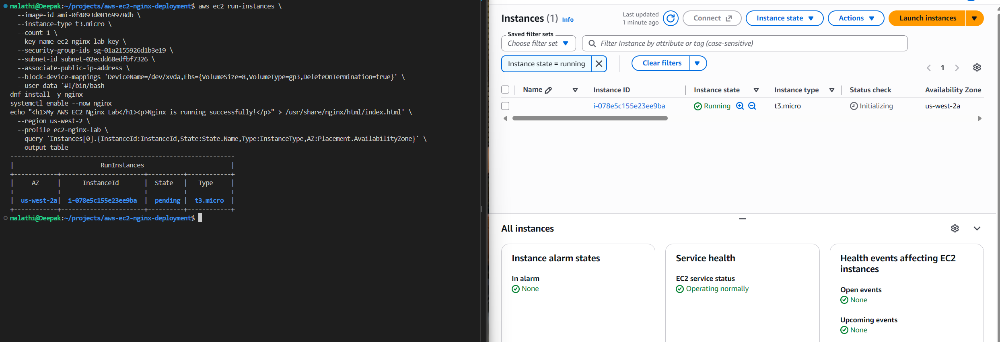

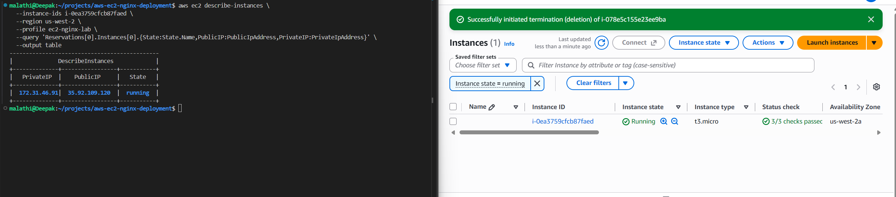

**Important:** Do not run the launch command twice unless you intentionally want another EC2 instance. Each successful run can create another billable instance.

---

## 19. Verify the deployment

Use the instance ID and public IP returned for your own deployment. Do not copy the historical instance ID or public IP into a new deployment.

### 19.1 Check instance state and addresses

Replace `<INSTANCE_ID>` with the ID returned by your launch command.

```bash
aws ec2 describe-instances --instance-ids <INSTANCE_ID> --region us-west-2 --profile ec2-nginx-lab --query 'Reservations[0].Instances[0].{InstanceId:InstanceId,State:State.Name,PublicIP:PublicIpAddress,PrivateIP:PrivateIpAddress,AZ:Placement.AvailabilityZone}' --output table
```

**Expected result:** The instance should eventually show state `running`. Record the current public and private IP addresses.

### 19.2 Test the homepage over HTTP

Replace `<PUBLIC_IP>` with the current public IPv4 address from the previous command.

```bash
curl -i --connect-timeout 5 http://<PUBLIC_IP>
```

**Expected result:** The response should include an HTTP success status and the HTML page created by the user-data script.

The original deployment returned:

```text
HTTP/1.1 200 OK
Server: nginx/1.30.6
Content-Type: text/html

<h1>My AWS EC2 Nginx Lab</h1><p>Nginx is running successfully!</p>
```

A second concise check was also successful:

```bash
curl -sS -o /dev/null -w 'HTTP status: %{http_code}\nResponse time: %{time_total}s\n' http://<PUBLIC_IP>/
```

Original observed output:

```text
HTTP status: 200
Response time: 0.511863s
```

This is one request's response time, not a long-term performance benchmark.

### 19.3 Verify NGINX service health over SSH

Replace `<PUBLIC_IP>` with the current public IPv4 address. Confirm that the private-key path and key pair match the instance.

```bash
ssh -i ~/.ssh/ec2-nginx-lab-key.pem -o StrictHostKeyChecking=accept-new ec2-user@<PUBLIC_IP> 'sudo systemctl is-active nginx'
```

**Expected result:**

```text
active
```

Original deployment screenshots:

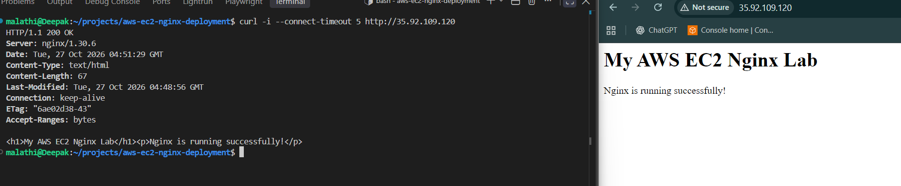

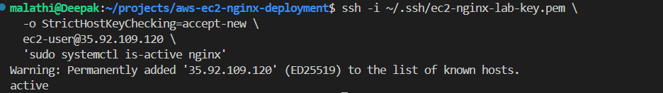

For more detail:

```bash
ssh -i ~/.ssh/ec2-nginx-lab-key.pem ec2-user@<PUBLIC_IP> 'sudo systemctl status nginx --no-pager'
```

Original observed evidence included `Active: active (running)`, `enabled`, and a successful NGINX configuration test (`nginx -t`).

---

## 20. Troubleshooting evidence

### 20.1 Inspect the system journal

Use the current public IP:

```bash
ssh -i ~/.ssh/ec2-nginx-lab-key.pem ec2-user@<PUBLIC_IP> 'sudo journalctl -u nginx -n 20 --no-pager'
```

The observed entries from the original lab showed normal service startup, a successful configuration test, and `Started nginx.service`. No startup error was present in the output shared during the lab.

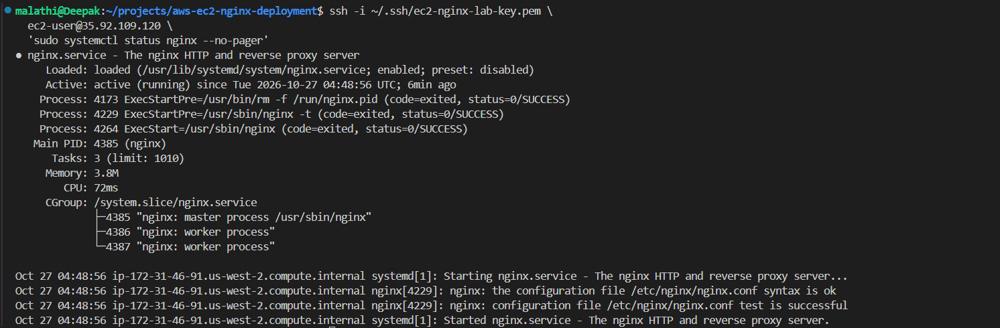

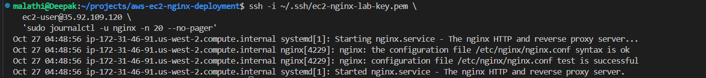

### 20.2 Inspect access logs

```bash
ssh -i ~/.ssh/ec2-nginx-lab-key.pem \
  ec2-user@<PUBLIC_IP> \
  'sudo tail -n 10 /var/log/nginx/access.log'
```

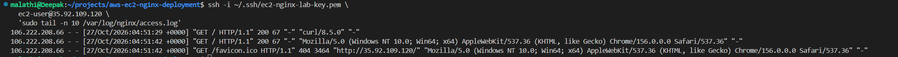

Original observed requests:

| Request | Status | Interpretation |
|:---|---:|:---|
| `GET /` from curl | `200` | Homepage request succeeded |
| `GET /` from Chrome | `200` | Browser loaded the homepage |
| `GET /favicon.ico` from Chrome | `404` | Browser requested an icon file that was not present |

### 20.3 Inspect the error log

```bash
ssh -i ~/.ssh/ec2-nginx-lab-key.pem ec2-user@<PUBLIC_IP> 'sudo tail -n 20 /var/log/nginx/error.log'
```

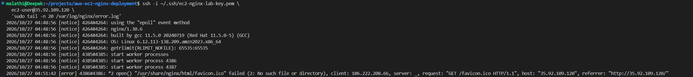

The relevant error said that `/usr/share/nginx/html/favicon.ico` did not exist. This explains the favicon `404`; it does **not** mean the homepage deployment failed. The main `/` endpoint continued returning `200 OK`. The other log entries were `[notice]` messages about normal NGINX startup.

**Troubleshooting approach:** Observe the symptom, collect service/log/HTTP evidence, interpret the evidence, and only then change something. Do not restart a service blindly when the evidence shows it is healthy.

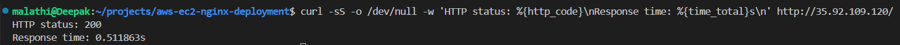

---

## 21. Cleanup and cost control

Before cleanup, preserve screenshots and notes needed for your demo. An initial instance was replaced during practice, so both instance IDs were considered during the original cleanup review.

### 21.1 Check the instance

Replace `<INSTANCE_ID>` with the instance ID returned by your launch command.

```bash
aws ec2 describe-instances --instance-ids <INSTANCE_ID> --region us-west-2 --profile ec2-nginx-lab --query 'Reservations[].Instances[].{ID:InstanceId,State:State.Name,PublicIP:PublicIpAddress}' --output table
```

### 21.2 Stop or terminate the instance

If you need the environment again soon, you can stop the instance:

```bash
aws ec2 stop-instances --instance-ids <INSTANCE_ID> --region us-west-2 --profile ec2-nginx-lab
```

If the lab is finished and the instance is no longer needed, terminate it instead:

```bash
aws ec2 terminate-instances --instance-ids <INSTANCE_ID> --region us-west-2 --profile ec2-nginx-lab
```

Do not execute both cleanup options as a routine sequence. Choose stop or terminate according to whether you need the instance again.

### 21.3 Verify termination

After termination, verify the final state:

```bash
aws ec2 describe-instances --instance-ids <INSTANCE_ID> --region us-west-2 --profile ec2-nginx-lab --query 'Reservations[].Instances[].{InstanceId:InstanceId,State:State.Name}' --output table
```

The root EBS volume was configured with `DeleteOnTermination=true`, but check for any other resources you created before deciding whether to delete them.

### 21.4 Review separately created resources

Terminating an instance does not automatically delete the standalone EC2 key pair or security group.

List the security group:

```bash
aws ec2 describe-security-groups --region us-west-2 --profile ec2-nginx-lab --group-ids <SECURITY_GROUP_ID>
```

If you have confirmed that the security group is dedicated to this lab, is no longer attached to any resource, and is safe to delete, run:

```bash
aws ec2 delete-security-group --group-id <SECURITY_GROUP_ID> --region us-west-2 --profile ec2-nginx-lab
```

If you no longer need the key pair, you can delete its AWS public-key record:

```bash
aws ec2 delete-key-pair --key-name <KEY_PAIR_NAME> --region us-west-2 --profile ec2-nginx-lab
```

Deleting the AWS key-pair record does not delete your local `.pem` file. Securely remove the local private key only when you are certain you no longer need it and have retained any required evidence.

Do not delete shared resources that another workload may use. Review the AWS Console and Billing dashboard for resources and charges beyond the specific items checked in this lab.

---

## 22. Deployment verification and cleanup results

### Deployment verification

The EC2 and NGINX deployment was successfully tested.

- EC2 instance `i-0ea3759cfcb87faed` was running at the last deployment verification.
- The NGINX service was active.
- SSH access worked successfully.
- The public homepage returned **HTTP 200 OK**.
- NGINX logs confirmed successful startup.
- A request for `/favicon.ico` returned `404 Not Found` because the favicon file was missing. This did not affect the homepage.

The instance was subsequently terminated. Its public IP is no longer a reliable endpoint and must be checked afresh if the lab is repeated.

### Cleanup results

The following cleanup checks were completed in the AWS Oregon region (`us-west-2`):

| Resource | Result |
|:---|:---|
| EC2 instance `i-0ea3759cfcb87faed` | Terminated |
| Lab security group `ec2-nginx-lab-sg` | Deleted and verified |
| EBS volumes | None listed in the console during the cleanup check |
| Elastic IP addresses | None found in the console during the cleanup check |
| EBS snapshots owned by me | None listed in the console during the cleanup check |
| NAT Gateways | None found in the console during the cleanup check |
| Load Balancers | None found in the console during the cleanup check |
| Auto Scaling Groups | None found in the console during the cleanup check |
| Default VPC, subnets, route table, and Internet Gateway | Retained; these were existing default networking resources |
| Lab IAM user, group, and policies | Retained |

The IAM user used for this lab did not have permission to describe network interfaces or EBS volumes through the AWS CLI. Those resources were checked using the AWS Console instead.

These results apply to the resources and region checked; they do not guarantee that no billable resources exist in other regions or AWS services.

### Repeating the lab

Before running the lab again:

1. Verify your AWS identity and Region.
2. Check the current state of EC2 instances and the availability of the required key pair and security group.
3. Confirm the current public IP address before configuring SSH access.
4. Discover the current VPC, subnet, and AMI values.
5. Create and verify the dedicated security group before launching the instance.
6. Confirm that the EC2 key pair exists and that its matching private key is available locally.
7. Follow the deployment steps in Section 18.
8. Verify HTTP, SSH, NGINX service health, and logs.
9. After practising, follow Section 21 to stop or terminate the instance and review resources created for the lab.

**Final status:** The EC2 + NGINX deployment was successfully tested and the instance was terminated. The lab security group was deleted. No EBS volumes, Elastic IP addresses, snapshots, NAT Gateways, Load Balancers, or Auto Scaling Groups were found in the Oregon-region checks. The default VPC networking and lab IAM setup were retained for future practice. These checks cover only the listed resource types and `us-west-2`; review AWS Billing for any account-wide charges.
