# AWS EC2 + NGINX Web Application Deployment

A beginner-friendly, step-by-step AWS lab that provisions an EC2
instance, installs NGINX with EC2 user data, serves a custom HTML page,
and verifies the deployment and service logs. The README records the
discovery phase, deployment commands, observed results, troubleshooting
evidence, screenshots, and cleanup guidance.

>  The EC2 + NGINX deployment was successfully verified before cleanup.
>  The homepage returned HTTP `200 OK`, SSH access succeeded, and the NGINX
service was active.
>  The instance `i-0ea3759cfcb87faed` was subsequently terminated, and the
lab security group `ec2-nginx-lab-sg` was deleted.
>  The cleanup checks documented below apply to the AWS Oregon region
(`us-west-2`) and the specific resource types inspected.
>  They do not guarantee that no billable resources or charges exist
elsewhere in the AWS account.

## Contents

-   [1. Project overview](#1-project-overview)
-   [2. Objectives](#2-objectives)
-   [3. Environment](#3-environment)
-   [4. Repository layout](#4-repository-layout)
-   [5. IAM setup](#5-iam-setup)
-   [6. Configure and verify AWS CLI](#6-configure-and-verify-aws-cli)
-   [7. Verify existing EC2 resources](#7-verify-existing-ec2-resources)
-   [8. Inspect the default VPC and
    subnets](#8-inspect-the-default-vpc-and-subnets)
-   [9. Inspect routing and Internet
    Gateway](#9-inspect-routing-and-internet-gateway)
-   [10. Inspect the network ACL](#10-inspect-the-network-acl)
-   [11. Check the AMI and instance
    type](#11-check-the-ami-and-instance-type)
-   [12. Check public-IP behavior](#12-check-public-ip-behavior)
-   [13. Inspect the existing security
    group](#13-inspect-the-existing-security-group)
-   [14. Verified findings](#14-verified-findings)
-   [15. Pending work](#15-pending-work)
-   [16. Security and cost notes](#16-security-and-cost-notes)
-   [17. Troubleshooting notes](#17-troubleshooting-notes)
-   [18. Launch the EC2 instance and install
    NGINX](#18-launch-the-ec2-instance-and-install-nginx)
-   [19. Verify the deployment](#19-verify-the-deployment)
-   [20. Troubleshooting evidence](#20-troubleshooting-evidence)
-   [21. Cleanup and cost control](#21-cleanup-and-cost-control)
-   [22. Current project status](#22-current-project-status)

------------------------------------------------------------------------

## 1. Project overview

This project demonstrates how to prepare an AWS environment for
deploying a basic web application on an EC2 instance and serving it
using NGINX.

The workflow deliberately begins with **read-only discovery**. Before
creating resources, we verify the AWS identity, permissions, VPC,
subnets, routes, Internet Gateway, network ACL, AMI options,
instance-type specifications, and existing security groups.

The deployment phase for the basic website is complete. The instance and
dedicated lab security group have since been cleaned up. Remaining
project work is to verify screenshot references, commit the final README
and screenshots, and rehearse the live demo.

## 2. Objectives

By completing this project, we aim to learn how to:

-   Configure AWS CLI with a named profile.
-   Verify which IAM identity is being used.
-   Use an IAM group and a discovery-only policy.
-   Inspect EC2 resources without launching an instance.
-   Understand VPCs, subnets, route tables, Internet Gateways, network
    ACLs, and security groups.
-   Select an appropriate Amazon Machine Image (AMI) and EC2 instance
    type.
-   Launch an EC2 instance and install NGINX with user data.
-   Verify public HTTP access, SSH access, service health, and NGINX
    logs.
-   Practise evidence-based troubleshooting and clean up billable
    resources.
-   Record the process with reproducible commands, expected results,
    screenshots, and troubleshooting notes.

## 3. Environment

| Item               | Current value                                                                                                                   |
|:-------------------|:--------------------------------------------------------------------------------------------------------------------------------|
| Local terminal     | WSL Ubuntu                                                                                                                      |
| Project directory  | `\~/projects/aws-ec2-nginx-deployment`                                                                                          |
| AWS CLI profile    | `ec2-nginx-lab`                                                                                                                 |
| AWS Region         | `us-west-2`                                                                                                                     |
| Region name        | US West (Oregon)                                                                                                                |
| IAM user           | `ec2-nginx-lab-user`                                                                                                            |
| IAM group          | `EC2-NGINX-Lab-Group`                                                                                                           |
| Inline IAM policy  | `EC2-NGINX-Lab-Discovery`                                                                                                       |
| VPC                | Default VPC                                                                                                                     |
| EC2 instance       | `i-0ea3759cfcb87faed` (terminated after successful testing)                                                                     |
| Instance type      | `t3.micro`                                                                                                                      |
| AMI                | `ami-0f4093d08169978db` (Amazon Linux 2023 x86-64)                                                                              |
| Subnet / AZ        | Historical deployment subnet: `subnet-02ecdd68edfbf7326` / `us-west-2a`                                                         |
| Lab security group | `ec2-nginx-lab-sg` (`sg-01a2155926d1b3e19`; deleted after testing)                                                              |
| NGINX              | Installed; service verified active before instance termination                                                                  |
| Website            | HTTP `200 OK` verified before cleanup; see note below about dynamic public IPs no longer available at the old instance endpoint |

**Credential safety:** Never commit access keys, secret access keys,
session tokens, private keys, or unredacted credential screenshots.
Enter credentials only into the appropriate local credential
configuration flow. If a credential is accidentally exposed, rotate or
revoke it promptly.

## 4. Repository layout

The screenshots are stored in the `screenshots/` directory. The image
paths in this README are relative to the repository root, so they will
render on GitHub when the images are committed alongside `README.md`.

``` text

aws-ec2-nginx-deployment/

├── README.md
└── screenshots/
    ├── 1-dashboard-iam-global.png
    ├── 2-iam-users-iam-global.png
    ├── 3-create-user-iam-global.png
    ├── 4-1-create-user-group-iam-global.png
    ├── 4-2-create-user-group-iam-global.png
    ├── 5-create-user-group-added.png
    ├── 6-1-create-user-iam-global.png
    ├── 6-2-user-created.png
    ├── 7-1-iam-user-groups.png
    ├── 7-2-ec2-nginx-lab-group-add-users.png
    ├── 7-3-add-users-selected.png
    ├── 7-4-ec2-nginx-lab-group-iam-global-user-added-in-group.png
    ├── 8-1-choose-permissions.png
    ├── 8-2-create-policy-select-json.png
    ├── 8-3-remove-existing-json.png
    ├── 8-4-replace-json-and-next.png
    ├── 8-5-ec2-describeroutetables-json-and-next.png
    ├── 8-6-policy-updated.png
    ├── 9-1-create-policy-iam.png
    ├── 9-2-ec2-nginx-lab-group-iam-permissions-created.png
    ├── 9-3-policy-is-attached-to-your-new-user-through-the-group.png
    ├── 10-1-ec2-nginx-lab-user-create-access-key.png
    ├── 10-2-select-command-line-interface-cli.png
    ├── 10-3-create-access-key-tag.png
    ├── 10-4-save-the-new-key-securely.png
    ├── 10-5-configure-the-profile-and-then-run-verification.png
    ├── 10-6-ec2-nginx-lab-user-iam-global.png
    ├── 10-7-default-vpc-available-in-oregon.png
    ├── 10-8-default-subnets-available-in-oregon.png
    ├── 11-1-inspect-existing-security-groups.png
    ├── 11-2-inspect-the-security-groups-inbound-rules.png
    ├── 11-3-inspect-the-security-groups-outbound-rules.png
    ├── 11-4-inspect-the-vpc-route-table.png
    ├── 11-4-verify-the-route-tables-associations.png
    ├── 11-5-check-the-internet-gateway.png
    ├── 11-6-check-network-acls.png
    ├── 11-7-verify-the-ami-and-instance-type.png
    ├── 11-8-verify-the-ec2-instance-type.png
    ├── 11-9-check-the-default-subnets-public-ip-setting.png
    └── 11-10-check-the-ec2-security-group-options.png
```

> The screenshot filenames above reflect the current local directory
> listing. If a file is renamed, update its reference in this README.

------------------------------------------------------------------------

## 5. IAM setup

### 5.1 Create the lab IAM group

The group created for this lab is:

`EC2-NGINX-Lab-Group`

IAM groups make it easier to manage permissions for users performing the
same lab tasks.

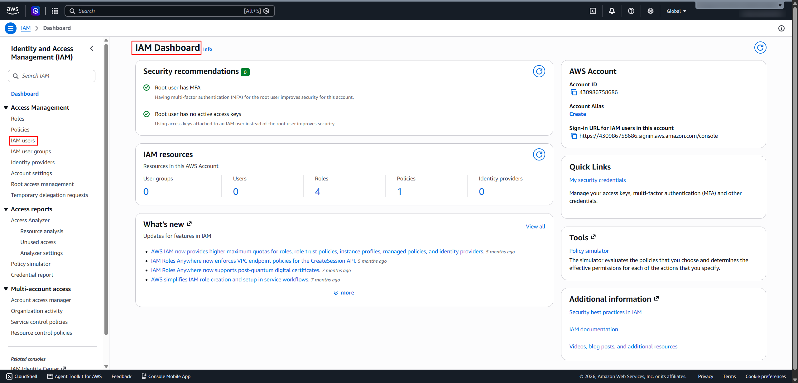

### 5.2 Create the lab IAM user

The user created for the lab is:

`ec2-nginx-lab-user`

The user is intended for AWS CLI access from WSL Ubuntu. Console sign-in
was not enabled for this user.

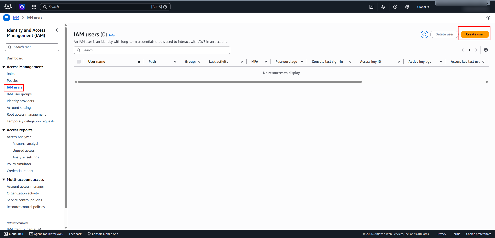

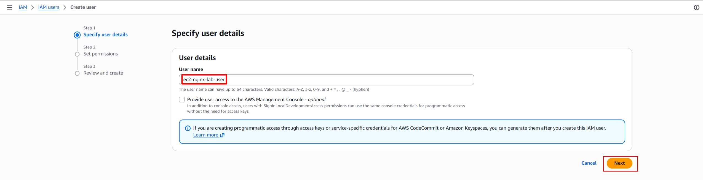

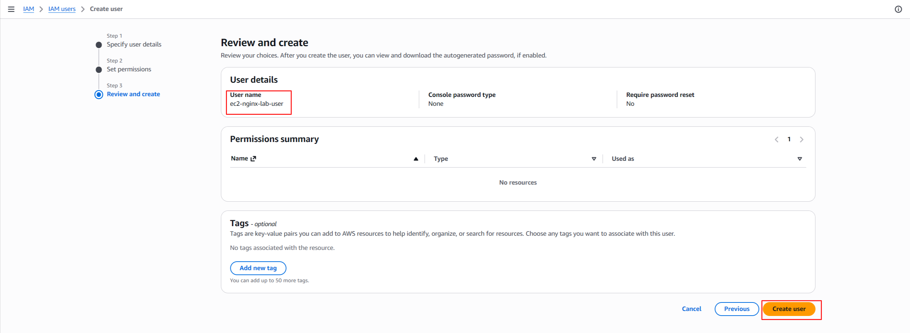

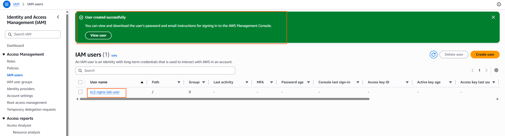

### 5.3 Add the user to the group

The user `ec2-nginx-lab-user` was added to `EC2-NGINX-Lab-Group`.

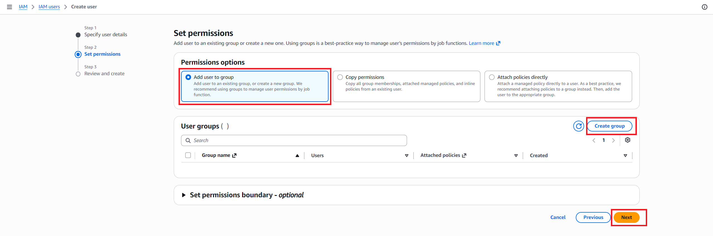


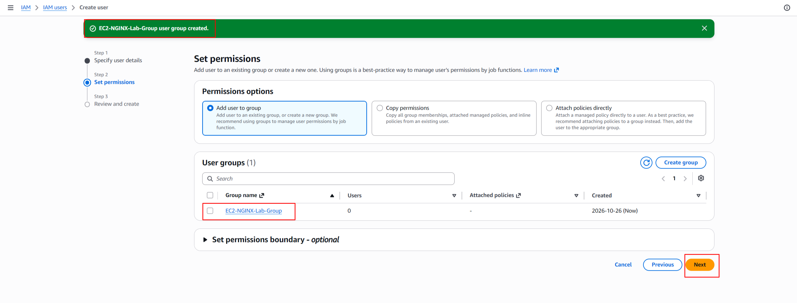

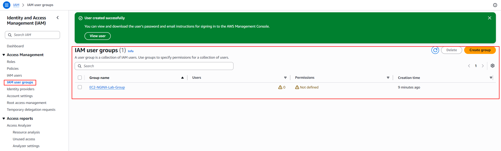


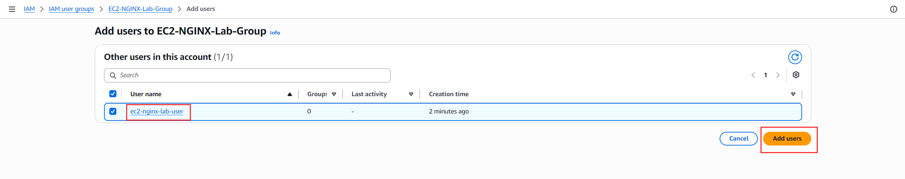


### 5.4 Create and attach the discovery policy

The inline policy is named:

`EC2-NGINX-Lab-Discovery`

Its purpose is to allow selected **read-only discovery operations**. It
is not intended to authorize instance creation, security-group
modification, key-pair creation, or other deployment changes.

The policy's action list was expanded as additional read-only checks
returned `UnauthorizedOperation`. The current intended action list is:

``` json

{
  "Version": "2012-10-17",
  "Statement": [
    {
      "Sid": "EC2ReadOnlyDiscovery",
      "Effect": "Allow",
      "Action": [
        "ec2:DescribeAvailabilityZones",
        "ec2:DescribeImages",
        "ec2:DescribeInstanceTypes",
        "ec2:DescribeInstances",
        "ec2:DescribeInternetGateways",
        "ec2:DescribeKeyPairs",
        "ec2:DescribeNetworkAcls",
        "ec2:DescribeRegions",
        "ec2:DescribeRouteTables",
        "ec2:DescribeSecurityGroups",
        "ec2:DescribeSubnets",
        "ec2:DescribeVpcs"
      ],
      "Resource": "\*"
    }
  ]
}
```

> This is the policy content intended to reflect the permissions added
> during discovery. Verify the saved policy in the AWS Console if you
> need to confirm its current live contents.

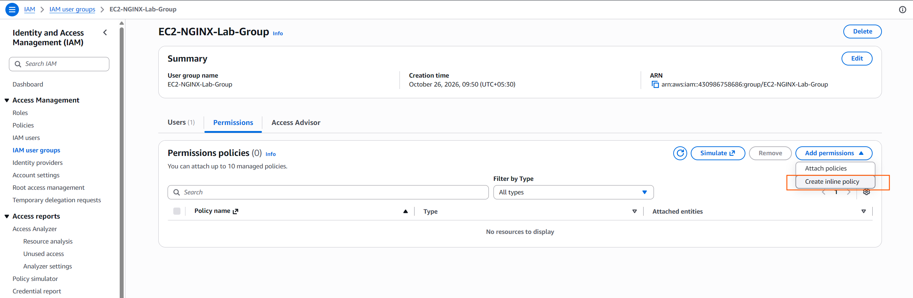


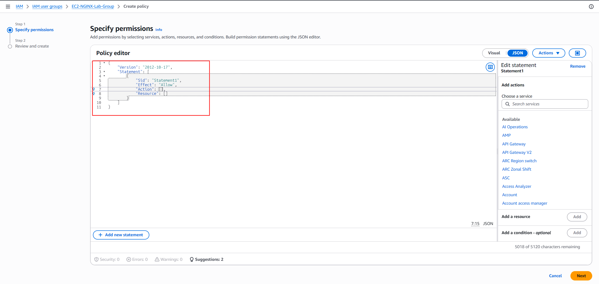


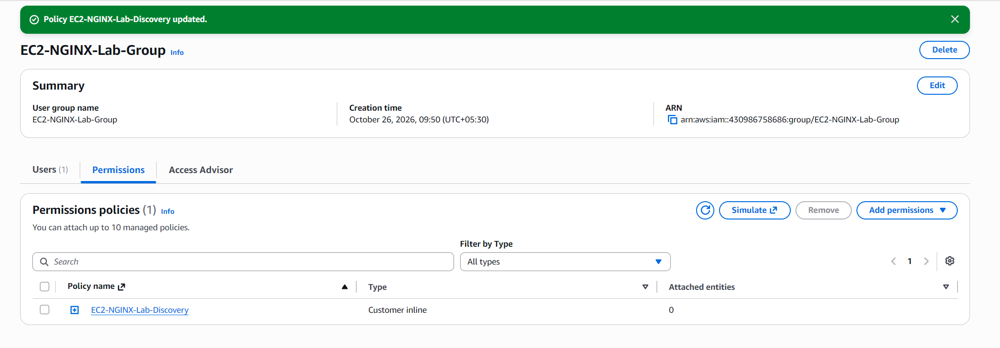

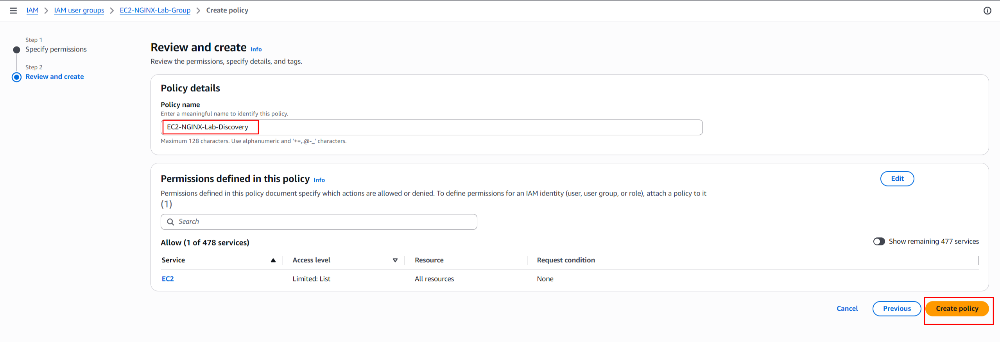


#### Policy explanation

| Policy element   | Meaning                                                                          |
|:-----------------|:---------------------------------------------------------------------------------|
| `Version`        | IAM policy language version                                                      |
| `Statement`      | Contains the permission statement                                                |
| `Sid`            | A descriptive identifier for the statement                                       |
| `Effect: Allow`  | Allows the listed actions, subject to other applicable policies and restrictions |
| `Action`         | Lists the permitted EC2 discovery operations                                     |
| `Resource: "\*"` | Uses all-resource scope for these supported describe actions                     |

The policy is for discovery only. The permissions required to create or
modify deployment resources must be planned separately and granted only
when needed.

------------------------------------------------------------------------

## 6. Configure and verify AWS CLI

### 6.1 Configure a named profile

Run in WSL Ubuntu:

``` bash

aws configure --profile ec2-nginx-lab
```

Enter the access key and secret access key for the lab identity when
prompted. Use the following non-secret configuration values:

``` text

Default region name: us-west-2

Default output format: json
```

Do not put actual credential values into this README.

The named profile keeps the lab's configuration separate from the
default AWS CLI profile.


### 6.2 Verify the active AWS identity

Run:

``` bash

aws sts get-caller-identity --profile ec2-nginx-lab
```

The command succeeded and identified the caller as the lab IAM user. The
account number and user ID are intentionally not reproduced here.

The ARN had this form:

``` text

arn:aws:iam::\<AWS_ACCOUNT_ID>:user/ec2-nginx-lab-user
```

**Result: Passed.** AWS authentication works with the `ec2-nginx-lab`
profile.

### 6.3 Verify profile configuration

Run:

``` bash

aws configure list --profile ec2-nginx-lab
```

The observed configuration showed:

-   Profile: `ec2-nginx-lab`
-   Access key source: shared credentials file
-   Secret key source: shared credentials file
-   Region: `us-west-2`, read from the AWS CLI configuration file

The credential values should remain masked in any screenshot or shared
output.

**Result: Passed.** The expected profile and region were confirmed.

### 6.4 Create access keys securely

The screenshots document the CLI access-key creation flow. Access keys
are credentials, not ordinary configuration data. Store them securely,
do not commit them to Git, and never include their values in
screenshots.


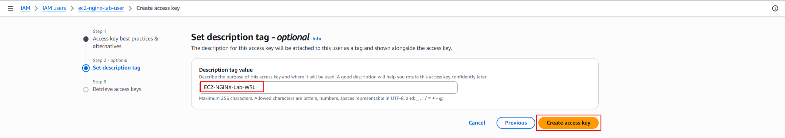


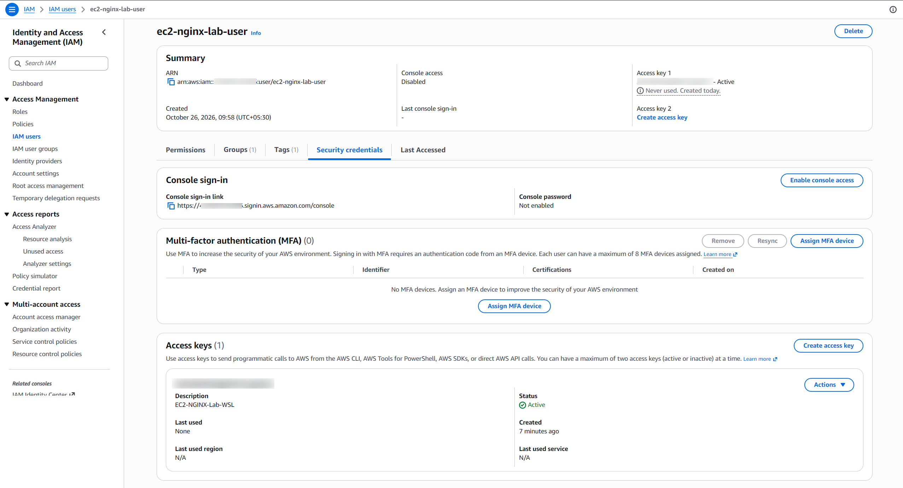

------------------------------------------------------------------------

## 7. Verify existing EC2 resources

All commands in this section are read-only.

### 7.1 Check existing instances

``` bash

aws ec2 describe-instances \\
  --region us-west-2 \\
  --profile ec2-nginx-lab \\
  --output table
```

The command succeeded and returned an empty table---no instances were
returned for this identity and region.

**Result: Passed.** The identity can call `ec2:DescribeInstances`; no
existing instances were returned by this query.

### 7.2 Check existing key pairs

``` bash

aws ec2 describe-key-pairs \\
  --region us-west-2 \\
  --profile ec2-nginx-lab \\
  --output table
```

The command succeeded and returned an empty table---no EC2 key pairs
were returned in this region.

**Result: Passed.** The identity can call `ec2:DescribeKeyPairs`. A key
pair has not been created for this lab.

------------------------------------------------------------------------

## 8. Inspect the default VPC and subnets

### 8.1 Discover the VPC

A VPC is a logically isolated network in AWS. EC2 instances launch into
a subnet within a VPC.

Run:

``` bash

aws ec2 describe-vpcs \\
  --region us-west-2 \\
  --profile ec2-nginx-lab \\
  --query "Vpcs[].{VpcId:VpcId,State:State,IsDefault:IsDefault,CidrBlock:CidrBlock}" \\
  --output table
```

The command returned this VPC:

| Field       | Observed value          |
|:------------|:------------------------|
| VPC ID      | `vpc-0307ce67a0df86851` |
| State       | `available`             |
| Default VPC | `True`                  |
| IPv4 CIDR   | `172.31.0.0/16`         |

The CIDR is the VPC's private IPv4 address range; it is not the public
IP address of an EC2 instance.


**Result: Passed.** An available default VPC was found. No VPC was
created or modified.

### 8.2 Discover subnets

Run:

``` bash

aws ec2 describe-subnets \\
  --region us-west-2 \\
  --profile ec2-nginx-lab \\
  --filters "Name=vpc-id,Values=vpc-0307ce67a0df86851" \\
  --query "Subnets[].{SubnetId:SubnetId,AZ:AvailabilityZone,State:State,DefaultForAZ:DefaultForAz,PublicIP:MapPublicIpOnLaunch,CIDR:CidrBlock}" \\
  --output table
```

Four available default subnets were returned:

| Availability Zone | Subnet ID                  | CIDR             | Default subnet for AZ | Auto-assign public IPv4 |
|:------------------|:---------------------------|:-----------------|:----------------------|:------------------------|
| `us-west-2a`      | `subnet-02ecdd68edfbf7326` | `172.31.32.0/20` | Yes                   | Yes                     |
| `us-west-2c`      | `subnet-003413e14c2375f32` | `172.31.0.0/20`  | Yes                   | Yes                     |
| `us-west-2d`      | `subnet-0ce894c858eab9c2e` | `172.31.48.0/20` | Yes                   | Yes                     |
| `us-west-2b`      | `subnet-006fde08c5f4e902c` | `172.31.16.0/20` | Yes                   | Yes                     |

`MapPublicIpOnLaunch: True` means the subnet is configured to assign
public IPv4 addresses to instances by default, unless overridden at
launch. It does not, by itself, guarantee internet connectivity.


**Result: Passed.** Four available default subnets were discovered. No
subnet was created or modified.

### 8.3 Verify the chosen subnet's public-IP setting

For a closer inspection of the subnet in `us-west-2a`, run:

``` bash

aws ec2 describe-subnets \\
  --region us-west-2 \\
  --profile ec2-nginx-lab \\
  --subnet-ids subnet-02ecdd68edfbf7326 \\
  --query "Subnets[].{SubnetId:SubnetId,AZ:AvailabilityZone,Cidr:CidrBlock,State:State,MapPublicIpOnLaunch:MapPublicIpOnLaunch,VpcId:VpcId}" \\
  --output table
```

Observed values:

-   Subnet: `subnet-02ecdd68edfbf7326`

-   Availability Zone: `us-west-2a`

-   CIDR: `172.31.32.0/20`

-   State: `available`

-   `MapPublicIpOnLaunch`: `True`

-   VPC: `vpc-0307ce67a0df86851`


------------------------------------------------------------------------

## 9. Inspect routing and Internet Gateway

### 9.1 Discover route tables

Run:

``` bash

aws ec2 describe-route-tables \\

  --region us-west-2 \\

  --profile ec2-nginx-lab \\

  --filters "Name=vpc-id,Values=vpc-0307ce67a0df86851" \\

  --query "RouteTables[].{RouteTableId:RouteTableId,Associations:Associations[].SubnetId,Routes:Routes[].{Destination:DestinationCidrBlock,Gateway:GatewayId,State:State}}" \\

  --output json
```

The discovered route table was `rtb-0bc5c0a06e2d2b2c0`. Its routes were:

| Destination     | Target                  | State    | Meaning                                        |
|:----------------|:------------------------|:---------|:-----------------------------------------------|
| `172.31.0.0/16` | `local`                 | `active` | Route for traffic within the VPC               |
| `0.0.0.0/0`     | `igw-0b25879d76a25f195` | `active` | Default IPv4 route toward the Internet Gateway |

The route table initially showed no explicit subnet associations.


### 9.2 Verify the route table's main association

Run:

``` bash

aws ec2 describe-route-tables \\

  --region us-west-2 \\

  --profile ec2-nginx-lab \\

  --route-table-ids rtb-0bc5c0a06e2d2b2c0 \\

  --query "RouteTables[].{RouteTableId:RouteTableId,MainAssociations:Associations[?Main==\\\`true\\\`].{Main:Main,VpcId:RouteTableId},SubnetAssociations:Associations[?SubnetId!=null].SubnetId}" \\

  --output json
```

The result confirmed:

-   Route table: `rtb-0bc5c0a06e2d2b2c0`

-   `Main: true`

-   No explicit subnet associations listed

**Note about the query:** The output key named `VpcId` in this command
was mistakenly populated from `RouteTableId`. Therefore, that displayed
field is not the VPC ID. The main-association result itself confirms
that this is the main route table. The actual VPC ID was independently
confirmed as `vpc-0307ce67a0df86851`.


Subnets without explicit route-table associations use the VPC's main
route table.

### 9.3 Verify the Internet Gateway attachment

Run:

``` bash

aws ec2 describe-internet-gateways \\

  --region us-west-2 \\

  --profile ec2-nginx-lab \\

  --internet-gateway-ids igw-0b25879d76a25f195 \\

  --query "InternetGateways[].{InternetGatewayId:InternetGatewayId,Attachments:Attachments[].{VpcId:VpcId,State:State}}" \\

  --output json
```

The command confirmed that:

-   Internet Gateway: `igw-0b25879d76a25f195`

-   Attached VPC: `vpc-0307ce67a0df86851`

-   Attachment state: `available`


**Networking interpretation:** An active default route and an attached
Internet Gateway are important prerequisites for public IPv4 internet
routing. They do not alone guarantee that a particular instance will be
reachable. Public-IP assignment, security groups, network ACLs, host
configuration, and other conditions still apply.

------------------------------------------------------------------------

## 10. Inspect the network ACL

A network ACL (NACL) is a subnet-level traffic filter. Unlike security
groups, network ACLs are **stateless**, so inbound and outbound traffic
must be considered separately.

Run:

``` bash

aws ec2 describe-network-acls \\

  --region us-west-2 \\

  --profile ec2-nginx-lab \\

  --filters "Name=vpc-id,Values=vpc-0307ce67a0df86851" \\

  --query "NetworkAcls[].{NetworkAclId:NetworkAclId,IsDefault:IsDefault,Associations:Associations[].SubnetId,Entries:Entries[].{RuleNumber:RuleNumber,Protocol:Protocol,RuleAction:RuleAction,Egress:Egress,CidrBlock:CidrBlock,PortRange:PortRange}}" \\

  --output json
```

The command returned:

-   Network ACL: `acl-0d28ab2e0e6e79bf6`

-   Default ACL: `true`

-   Associated subnets: all four subnets discovered above

-   Rule `100`: allow all protocols for IPv4 `0.0.0.0/0`, for both
    inbound (`Egress: false`) and outbound (`Egress: true`)

-   Rule `32767`: deny-all catch-all, for both directions

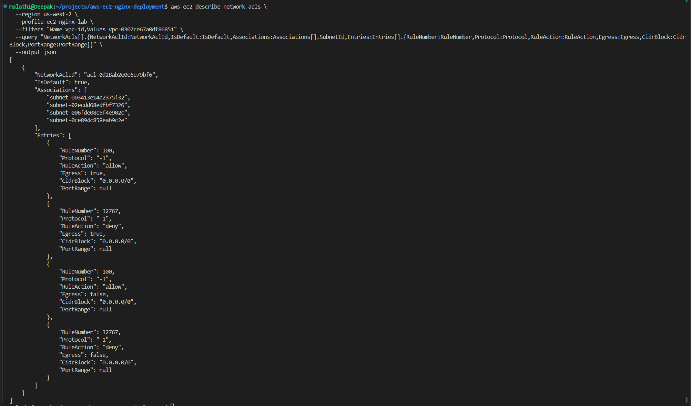

The rule numbered `100` is evaluated before the catch-all rule `32767`.
Since the allow rule matches all IPv4 traffic, the later deny rule does
not override it.

**Security note:** `0.0.0.0/0` means all IPv4 addresses. We should not
rely on the default NACL to restrict access to the Nginx instance. The
instance's security group should allow only the intended inbound
traffic.

------------------------------------------------------------------------

## 11. Check the AMI and instance type

### 11.1 Discover Amazon Linux 2023 AMIs

Run:

``` bash

aws ec2 describe-images \\

  --region us-west-2 \\

  --profile ec2-nginx-lab \\

  --owners amazon \\

  --filters \\

    "Name=name,Values=al2023-ami-2023.\*-x86_64" \\

    "Name=state,Values=available" \\

    "Name=architecture,Values=x86_64" \\

    "Name=root-device-type,Values=ebs" \\

  --query "Images | sort_by(@, &CreationDate)[-5:].{ImageId:ImageId,Name:Name,CreationDate:CreationDate,Architecture:Architecture}" \\

  --output json
```

Five available Amazon Linux 2023 AMIs were returned. Examples from the
observed output include:

| AMI ID                  | Image name                                         | Architecture |
|:------------------------|:---------------------------------------------------|:-------------|
| `ami-0e0fcdc77c6355731` | `al2023-ami-2023.12.20261021.0-kernel-6.18-x86_64` | `x86_64`     |
| `ami-0ce59d8f4219233f7` | `al2023-ami-2023.12.20261021.0-kernel-6.12-x86_64` | `x86_64`     |
| `ami-0f4093d08169978db` | `al2023-ami-2023.12.20261026.1-kernel-6.12-x86_64` | `x86_64`     |
| `ami-074462d12abec759f` | `al2023-ami-2023.12.20261026.1-kernel-6.1-x86_64`  | `x86_64`     |
| `ami-0829b74b2a8c619b7` | `al2023-ami-2023.12.20261026.1-kernel-6.18-x86_64` | `x86_64`     |

The image query returned available images owned by Amazon, with x86-64
architecture and EBS root devices. AMI IDs are region-specific, and the
latest available image may change over time.


**Status:** AMI discovery succeeded. The final AMI selection should be
confirmed again immediately before launching the instance.

### 11.2 Check `t3.micro` specifications

Run:

``` bash

aws ec2 describe-instance-types \\

  --region us-west-2 \\

  --profile ec2-nginx-lab \\

  --instance-types t3.micro \\

  --query "InstanceTypes[].{InstanceType:InstanceType,Architectures:ProcessorInfo.SupportedArchitectures,vCPUs:VCpuInfo.DefaultVCpus,MemoryMiB:MemoryInfo.SizeInMiB}" \\

  --output table
```

The output confirmed:

| Property      | Result             |
|:--------------|:-------------------|
| Instance type | `t3.micro`         |
| Architecture  | `x86_64`           |
| vCPUs         | `2`                |
| Memory        | `1024 MiB` (1 GiB) |


The `x86_64` instance architecture matches the discovered x86-64 AMI
candidates.

**Important:** This command confirms the instance type's specifications.
It does not confirm account quota, Availability Zone capacity, launch
permissions, or cost eligibility. Check current AWS pricing and account
eligibility before provisioning; do not assume the instance is free.

------------------------------------------------------------------------

## 12. Check public-IP behavior

The subnet `subnet-02ecdd68edfbf7326` in `us-west-2a` returned
`MapPublicIpOnLaunch: true`.

This setting means automatic public IPv4 assignment is enabled for
launches in that subnet unless the launch configuration overrides it. It
does not prove that a running application will be reachable.

The network prerequisites to consider together are:

1\. The subnet's public-IP assignment behavior.

2\. The main route table's default route to the Internet Gateway.

3\. The Internet Gateway's attachment to the VPC.

4\. Security-group inbound and outbound rules.

5\. Network ACL inbound and outbound rules.

6\. The instance's operating system and application configuration.

------------------------------------------------------------------------

## 13. Inspect the existing security group

### 13.1 List security groups in the VPC

Run:

``` bash

aws ec2 describe-security-groups \\

  --region us-west-2 \\

  --profile ec2-nginx-lab \\

  --filters "Name=vpc-id,Values=vpc-0307ce67a0df86851" \\

  --query "SecurityGroups[].{GroupId:GroupId,GroupName:GroupName,Description:Description,VpcId:VpcId}" \\

  --output table
```

Only the default security group was returned:

  Field         Value
  ------------- ------------------------------
  Group ID      `sg-03b944b8175124bda`
  Group name    `default`
  Description   `default VPC security group`
  VPC           `vpc-0307ce67a0df86851`


### 13.2 Inspect the default security group's inbound rules

Run:

``` bash

aws ec2 describe-security-groups \\

  --region us-west-2 \\

  --profile ec2-nginx-lab \\

  --group-ids sg-03b944b8175124bda \\

  --query "SecurityGroups[].{GroupId:GroupId,Inbound:IpPermissions}" \\

  --output json
```

The observed inbound rule allowed all protocols from resources
associated with the **same security group**. The output did not show an
IPv4 CIDR or IPv6 CIDR as an inbound source.


This is not the same as allowing inbound access from the whole internet.
The default security group is not the intended public-web access policy
for this lab.

### 13.3 Inspect the default security group's outbound rules

Run:

``` bash

aws ec2 describe-security-groups \\

  --region us-west-2 \\

  --profile ec2-nginx-lab \\

  --group-ids sg-03b944b8175124bda \\

  --query "SecurityGroups[].{GroupId:GroupId,Outbound:IpPermissionsEgress}" \\

  --output json
```

The observed outbound rule allowed all protocols to IPv4 destination
`0.0.0.0/0`.


**Important:** An outbound security-group rule is not proof of internet
connectivity. Routing, gateway attachment, public addressing, NACLs, and
host configuration also matter.

### 13.4 Decide on the lab security group

Before deployment, create or select a **dedicated security group** for
the Nginx instance, using an authorized identity and a deliberate
inbound policy. A typical public HTTP demonstration needs inbound TCP
port `80` from the intended audience. SSH access on TCP port `22`, if
needed, should be restricted to the user's trusted IP address or
replaced with an appropriate managed access method. HTTPS on TCP port
`443` should be opened only if TLS is configured for the lab.

Do not use a broad inbound rule such as all protocols from `0.0.0.0/0`.


------------------------------------------------------------------------

## 14. Verified findings (pre-deployment discovery)

The following table records what was found during the initial read-only
discovery phase. Some rows are historical snapshots from before the lab
resources were created; they are not the current resource inventory.

| Check                    | Result at discovery time                                                                                                             |
|:-------------------------|:-------------------------------------------------------------------------------------------------------------------------------------|
| AWS CLI named profile    | `ec2-nginx-lab` configured                                                                                                           |
| AWS identity             | Verified with STS                                                                                                                    |
| Region                   | `us-west-2` (Oregon)                                                                                                                 |
| Existing EC2 instances   | None returned before this lab's launch                                                                                               |
| Existing EC2 key pairs   | None returned before this lab's key pair was created                                                                                 |
| Default VPC              | `vpc-0307ce67a0df86851`, CIDR `172.31.0.0/16`                                                                                        |
| Selected subnet          | `subnet-02ecdd68edfbf7326`, `us-west-2a`, `172.31.32.0/20`                                                                           |
| Main route table         | `rtb-0bc5c0a06e2d2b2c0`, active default route to the Internet Gateway                                                                |
| Internet Gateway         | `igw-0b25879d76a25f195`, attached to the VPC                                                                                         |
| Network ACL              | Default ACL; IPv4 allow entries in both directions                                                                                   |
| AMI                      | Amazon Linux 2023 x86-64 image verified available before launch                                                                      |
| Instance type            | `t3.micro`, x86-64, 2 vCPUs, 1 GiB memory                                                                                            |
| Dedicated security group | Created for the lab; HTTP 80 public, SSH 22 restricted to the current public IP at setup time                                        |
| Launch permission check  | IAM Policy Simulator showed `RunInstances` allowed for subnet, image, instance, network-interface, and security-group resource types |

## 15. Pending work

-   [ ] Organize and verify all screenshots referenced by this README
    are present in `screenshots/` and commit them to GitHub.

-   [ ] Rehearse the 60-minute live demo from a clean checklist and
    explain each command in your own words.

-   [ ] Decide whether to add a favicon (the missing favicon is
    cosmetic; the homepage works).

-   [x] Terminate the EC2 instance and verify the lab security group was
    deleted.

-   [ ] Verify all screenshot references and commit the final README and
    screenshots to GitHub.

## 16. Security and cost notes

-   Never commit AWS access keys, secret access keys, session tokens, or
    private SSH keys.

-   The SSH inbound rule was restricted to the public IP observed during
    setup. If your IP changes, update the rule carefully before SSH; do
    not open port 22 to `0.0.0.0/0`.

-   HTTP port 80 is intentionally open to the internet for this demo. Do
    not send sensitive data over plain HTTP.

-   The instance uses an 8 GiB `gp3` EBS root volume with
    `DeleteOnTermination=true`.

-   EC2 compute, EBS storage, public IPv4, data transfer, and other
    resources may incur charges. Stopping an instance generally stops
    compute charges, but retained storage and public IPv4 may still be
    billed. Confirm current pricing and account eligibility.

-   When the lab is complete, preserve screenshots and notes, then
    terminate the instance if you no longer need it. Verify the result
    in the AWS console or with `describe-instances`.

## 17. Troubleshooting notes

### `UnauthorizedOperation`

Example:

``` text

You are not authorized to perform: ec2:DescribeNetworkAcls
```

**Meaning:** The IAM identity does not have an applicable allow for the
requested action, or another policy restriction applies.

**Resolution used in this lab:** Add the specific missing read-only
`ec2:Describe...` action to the existing discovery policy, if
authorized, then retry the same read-only command. If you cannot edit
IAM policies, request help from an authorized administrator. Do not
grant yourself broader permissions to bypass the error.

### Empty output from `describe-instances` or `describe-key-pairs`

An empty result can mean no matching resources were returned for the
identity and Region. It is not, by itself, evidence of an error.

### An Internet Gateway route does not guarantee reachability

Check public-IP assignment, the route table, gateway attachment,
security groups, NACLs, host firewall, and whether the service is
listening on the intended port.

## 18. Launch the EC2 instance and install NGINX

The launch was performed from WSL Ubuntu using the named profile. The
command created one Amazon Linux 2023 instance, attached the dedicated
security group and existing key pair, requested a public IPv4 address,
configured an 8 GiB `gp3` root volume, and used EC2 user data to install
and start NGINX.

> **Reproducibility note:** AMI IDs and public IP addresses can change.
> Re-check the AMI and your current SSH source IP before re-running this
> lab. Do not run the launch command twice unless you intentionally want
> another instance.

``` bash
aws ec2 run-instances \
  --image-id ami-0f4093d08169978db \
  --instance-type t3.micro \
  --count 1 \
  --key-name ec2-nginx-lab-key \
  --security-group-ids sg-01a2155926d1b3e19 \
  --subnet-id subnet-02ecdd68edfbf7326 \
  --associate-public-ip-address \
  --block-device-mappings 'DeviceName=/dev/xvda,Ebs={VolumeSize=8,VolumeType=gp3,DeleteOnTermination=true}' \
  --user-data '#!/bin/bash
dnf install -y nginx
systemctl enable --now nginx
echo "<h1>My AWS EC2 Nginx Lab</h1><p>Nginx is running successfully!</p>" > /usr/share/nginx/html/index.html' \
  --region us-west-2 \
  --profile ec2-nginx-lab \
  --query 'Instances[0].{InstanceId:InstanceId,State:State.Name,Type:InstanceType,AZ:Placement.AvailabilityZone}' \
  --output table
```

The instance was `i-0ea3759cfcb87faed`, launched in `us-west-2a` as a
`t3.micro`. Its observed private IP was `172.31.46.91` and public IPv4
address was `35.92.109.120` at the time of testing. Public IPs are
dynamic and may change after stop/start.


## 19. Verify the deployment

### 19.1 Check instance state and addresses

``` bash
aws ec2 describe-instances \
  --instance-ids i-0ea3759cfcb87faed \
  --region us-west-2 \
  --profile ec2-nginx-lab \
  --query 'Reservations[0].Instances[0].{State:State.Name,PublicIP:PublicIpAddress,PrivateIP:PrivateIpAddress}' \
  --output table
```

Observed state: `running`. Observed public IP at test time:
`35.92.109.120`.

### 19.2 Test the homepage over HTTP

``` bash
curl -i --connect-timeout 5 http://35.92.109.120
```

Observed response included:

``` text
HTTP/1.1 200 OK
Server: nginx/1.30.6
Content-Type: text/html

<h1>My AWS EC2 Nginx Lab</h1><p>Nginx is running successfully!</p>
```

A second concise check was also successful:

``` bash
curl -sS -o /dev/null -w 'HTTP status: %{http_code}\nResponse time: %{time_total}s\n' http://35.92.109.120/
```

Observed output:

``` text
HTTP status: 200
Response time: 0.511863s
```

This is one request's response time, not a long-term performance
benchmark.

### 19.3 Verify NGINX service health over SSH

``` bash
ssh -i ~/.ssh/ec2-nginx-lab-key.pem \
  -o StrictHostKeyChecking=accept-new \
  ec2-user@35.92.109.120 \
  'sudo systemctl is-active nginx'
```

Observed output: `active`.

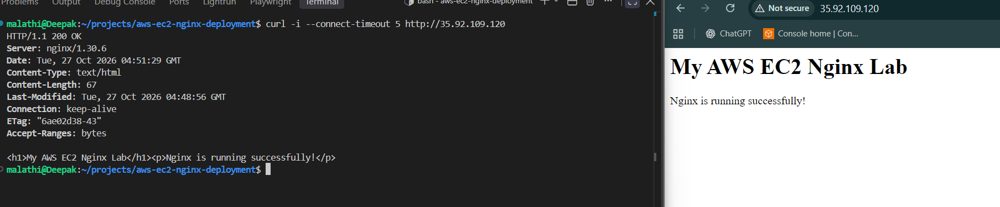


For more detail:

``` bash
ssh -i ~/.ssh/ec2-nginx-lab-key.pem \
  ec2-user@35.92.109.120 \
  'sudo systemctl status nginx --no-pager'
```

Observed evidence included `Active: active (running)`, `enabled`, and a
successful NGINX configuration test (`nginx -t`).

## 20. Troubleshooting evidence

### 20.1 Inspect the system journal

``` bash
ssh -i ~/.ssh/ec2-nginx-lab-key.pem \
  ec2-user@35.92.109.120 \
  'sudo journalctl -u nginx -n 20 --no-pager'
```

The observed entries showed normal service startup, a successful
configuration test, and `Started nginx.service`. No startup error was
present in the output shared during the lab.

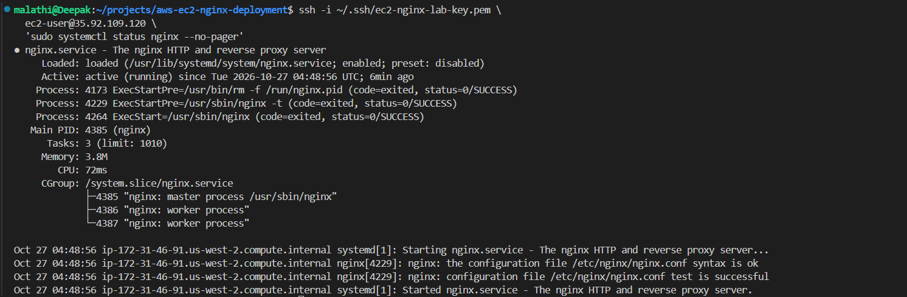

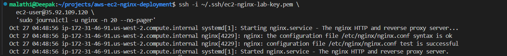

### 20.2 Inspect access logs

``` bash
ssh -i ~/.ssh/ec2-nginx-lab-key.pem \
  ec2-user@35.92.109.120 \
  'sudo tail -n 10 /var/log/nginx/access.log'
```


Observed requests:

| Request                        | Status | Interpretation                                      |
|:-------------------------------|-------:|:----------------------------------------------------|
| `GET /` from curl              |  `200` | Homepage request succeeded                          |
| `GET /` from Chrome            |  `200` | Browser loaded the homepage                         |
| `GET /favicon.ico` from Chrome |  `404` | Browser requested an icon file that was not present |

### 20.3 Inspect the error log

``` bash
ssh -i ~/.ssh/ec2-nginx-lab-key.pem \
  ec2-user@35.92.109.120 \
  'sudo tail -n 20 /var/log/nginx/error.log'
```


The relevant error said that `/usr/share/nginx/html/favicon.ico` did not
exist. This explains the favicon `404`; it does **not** mean the
homepage deployment failed. The main `/` endpoint continued returning
`200 OK`. The other log entries were `[notice]` messages about normal
NGINX startup.

**Troubleshooting approach:** Observe the symptom, collect
service/log/HTTP evidence, interpret the evidence, and only then change
something. Do not restart a service blindly when the evidence shows it
is healthy.


## 21. Cleanup and cost control

Before cleanup, preserve screenshots and notes needed for your demo. An
initial instance was replaced during practice, so both instance IDs were
considered during the cleanup review.

Check the instances:

``` bash
aws ec2 describe-instances \
  --instance-ids i-0ea3759cfcb87faed \
  --region us-west-2 \
  --profile ec2-nginx-lab \
  --query 'Reservations[].Instances[].{ID:InstanceId,State:State.Name,PublicIP:PublicIpAddress}' \
  --output table
```

If you need the environment again soon, you can stop the instance:

``` bash
aws ec2 stop-instances \
  --instance-ids i-0ea3759cfcb87faed \
  --region us-west-2 \
  --profile ec2-nginx-lab
```

If the lab is finished and the instance is no longer needed, terminate
it instead:

``` bash
aws ec2 terminate-instances \
  --instance-ids i-0ea3759cfcb87faed \
  --region us-west-2 \
  --profile ec2-nginx-lab
```

Do not execute both cleanup options as a routine sequence. Choose stop
or terminate according to whether you need the instance again. After
termination, verify the final state. The root EBS volume was configured
with `DeleteOnTermination=true`, but check for any other resources you
created (such as the key pair and security group) before deciding
whether to delete them. Terminating an instance does not automatically
delete the standalone EC2 key pair or security group. Do not delete
shared resources that another workload may use.

## 22. Deployment Verification and Cleanup Results

### Deployment Verification

The EC2 and NGINX deployment was successfully tested.

-   EC2 instance `i-0ea3759cfcb87faed` was running at the last
    deployment verification.
-   The NGINX service was active.
-   SSH access worked successfully.
-   The public homepage returned **HTTP 200 OK**.
-   NGINX logs confirmed successful startup.
-   A request for `/favicon.ico` returned `404 Not Found` because the
    favicon file was missing. This did not affect the homepage.

The instance was subsequently terminated. Its public IP is no longer a
reliable endpoint and must be checked afresh if the lab is repeated.

### Cleanup Results

The following cleanup checks were completed in the AWS Oregon region
(`us-west-2`):

| Resource                                                | Result                                                     |
|:--------------------------------------------------------|:-----------------------------------------------------------|
| EC2 instance `i-0ea3759cfcb87faed`                      | Terminated                                                 |
| Lab security group `ec2-nginx-lab-sg`                   | Deleted and verified                                       |
| EBS volumes                                             | None listed in the console during the cleanup check        |
| Elastic IP addresses                                    | None found in the console during the cleanup check         |
| EBS snapshots owned by me                               | None listed in the console during the cleanup check        |
| NAT Gateways                                            | None found in the console during the cleanup check         |
| Load Balancers                                          | None found in the console during the cleanup check         |
| Auto Scaling Groups                                     | None found in the console during the cleanup check         |
| Default VPC, subnets, route table, and Internet Gateway | Retained; these were existing default networking resources |
| Lab IAM user, group, and policies                       | Retained                                                   |

The IAM user used for this lab did not have permission to describe
network interfaces or EBS volumes through the AWS CLI. Those resources
were checked using the AWS Console instead.

These results apply to the resources and region checked; they do not
guarantee that no billable resources exist in other regions or AWS
services.

### Repeating the Lab

Before running the lab again:

1.  Verify your AWS identity and region.
2.  Check the current state of EC2 instances and the availability of the
    required key pair and security group.
3.  Confirm the current public IP address before configuring SSH access.
4.  Follow the deployment steps in this README.
5.  After practising, follow Section 21 to stop or terminate the
    instance and review resources created for the lab.

**Final status:** The EC2 + NGINX deployment was successfully tested and
the instance was terminated. The lab security group was deleted. No EBS
volumes, Elastic IP addresses, snapshots, NAT Gateways, Load Balancers,
or Auto Scaling Groups were found in the Oregon-region checks. The
default VPC networking and lab IAM setup were retained for future
practice. These checks cover only the listed resource types and
`us-west-2`; review AWS Billing for any account-wide charges.
