# AWS EC2 + NGINX Web Application Deployment

A beginner-friendly, step-by-step AWS lab that prepares an EC2 environment for a basic NGINX web server. The project is being documented as the work progresses, with commands, observed results, screenshots, and verification notes.

> **Current status:** AWS CLI access and read-only environment discovery are in progress/completed for the checks listed below. **No EC2 instance has been launched, NGINX has not been installed, and no web application has been deployed.**

## Contents

- [1. Project overview](#1-project-overview)
- [2. Objectives](#2-objectives)
- [3. Environment](#3-environment)
- [4. Repository layout](#4-repository-layout)
- [5. IAM setup](#5-iam-setup)
- [6. Configure and verify AWS CLI](#6-configure-and-verify-aws-cli)
- [7. Verify existing EC2 resources](#7-verify-existing-ec2-resources)
- [8. Inspect the default VPC and subnets](#8-inspect-the-default-vpc-and-subnets)
- [9. Inspect routing and Internet Gateway](#9-inspect-routing-and-internet-gateway)
- [10. Inspect the network ACL](#10-inspect-the-network-acl)
- [11. Check the AMI and instance type](#11-check-the-ami-and-instance-type)
- [12. Check public-IP behavior](#12-check-public-ip-behavior)
- [13. Inspect the existing security group](#13-inspect-the-existing-security-group)
- [14. Verified findings](#14-verified-findings)
- [15. Pending work](#15-pending-work)
- [16. Security and cost notes](#16-security-and-cost-notes)
- [17. Troubleshooting notes](#17-troubleshooting-notes)

---

## 1. Project overview

This project demonstrates how to prepare an AWS environment for deploying a basic web application on an EC2 instance and serving it using NGINX.

The workflow deliberately begins with **read-only discovery**. Before creating resources, we verify the AWS identity, permissions, VPC, subnets, routes, Internet Gateway, network ACL, AMI options, instance-type specifications, and existing security groups.

The later deployment phase will cover EC2 provisioning, secure access, NGINX installation, website verification, troubleshooting, and cleanup.

## 2. Objectives

By completing this project, we aim to learn how to:

- Configure AWS CLI with a named profile.
- Verify which IAM identity is being used.
- Use an IAM group and a discovery-only policy.
- Inspect EC2 resources without launching an instance.
- Understand VPCs, subnets, route tables, Internet Gateways, network ACLs, and security groups.
- Select an appropriate Amazon Machine Image (AMI) and EC2 instance type.
- Deploy and verify NGINX in a later stage.
- Record the process with reproducible commands, expected results, screenshots, and troubleshooting notes.

## 3. Environment

| Item | Current value |
|---|---|
| Local terminal | WSL Ubuntu |
| Project directory | `~/projects/aws-ec2-nginx-deployment` |
| AWS CLI profile | `ec2-nginx-lab` |
| AWS Region | `us-west-2` |
| Region name | US West (Oregon) |
| IAM user | `ec2-nginx-lab-user` |
| IAM group | `EC2-NGINX-Lab-Group` |
| Inline IAM policy | `EC2-NGINX-Lab-Discovery` |
| VPC | Default VPC |
| EC2 instance | **Not launched** |
| NGINX | **Not installed** |
| Web application | **Not deployed** |

**Credential safety:** Never commit access keys, secret access keys, session tokens, private keys, or unredacted credential screenshots. Enter credentials only into the appropriate local credential configuration flow. If a credential is accidentally exposed, rotate or revoke it promptly.

## 4. Repository layout

The screenshots are stored in the `screenshots/` directory. The image paths in this README are relative to the repository root, so they will render on GitHub when the images are committed alongside `README.md`.

```text
aws-ec2-nginx-deployment/
├── README.md
└── screenshots/
    ├── 1-dashboard-iam-global.png
    ├── 2-iam-users-iam-global.png
    ├── 3-create-user-iam-global.png
    ├── 4-1-create-user-group-iam-global.png
    ├── 4-2-create-user-group-iam-global.png
    ├── 5-create-user-group-added.png
    ├── 6-1-create-user-iam-global.png
    ├── 6-2-user-created.png
    ├── 7-1-iam-user-groups.png
    ├── 7-2-ec2-nginx-lab-group-add-users.png
    ├── 7-3-add-users-selected.png
    ├── 7-4-ec2-nginx-lab-group-iam-global-user-added-in-group.png
    ├── 8-1-choose-permissions.png
    ├── 8-2-create-policy-select-json.png
    ├── 8-3-remove-existing-json.png
    ├── 8-4-replace-json-and-next.png
    ├── 8-5-ec2-describeroutetables-json-and-next.png
    ├── 8-6-policy-updated.png
    ├── 9-1-create-policy-iam.png
    ├── 9-2-ec2-nginx-lab-group-iam-permissions-created.png
    ├── 9-3-policy-is-attached-to-your-new-user-through-the-group.png
    ├── 10-1-ec2-nginx-lab-user-create-access-key.png
    ├── 10-2-select-command-line-interface-cli.png
    ├── 10-3-create-access-key-tag.png
    ├── 10-4-save-the-new-key-securely.png
    ├── 10-5-configure-the-profile-and-then-run-verification.png
    ├── 10-6-ec2-nginx-lab-user-iam-global.png
    ├── 10-7-default-vpc-available-in-oregon.png
    ├── 10-8-default-subnets-available-in-oregon.png
    ├── 11-1-inspect-existing-security-groups.png
    ├── 11-2-inspect-the-security-groups-inbound-rules.png
    ├── 11-3-inspect-the-security-groups-outbound-rules.png
    ├── 11-4-inspect-the-vpc-route-table.png
    ├── 11-4-verify-the-route-tables-associations.png
    ├── 11-5-check-the-internet-gateway.png
    ├── 11-6-check-network-acls.png
    ├── 11-7-verify-the-ami-and-instance-type.png
    ├── 11-8-verify-the-ec2-instance-type.png
    ├── 11-9-check-the-default-subnets-public-ip-setting.png
    └── 11-10-check-the-ec2-security-group-options.png
```

> The screenshot filenames above reflect the current local directory listing. If a file is renamed, update its reference in this README.

---

## 5. IAM setup

### 5.1 Create the lab IAM group

The group created for this lab is:

`EC2-NGINX-Lab-Group`

IAM groups make it easier to manage permissions for users performing the same lab tasks.


### 5.2 Create the lab IAM user

The user created for the lab is:

`ec2-nginx-lab-user`

The user is intended for AWS CLI access from WSL Ubuntu. Console sign-in was not enabled for this user.


### 5.3 Add the user to the group

The user `ec2-nginx-lab-user` was added to `EC2-NGINX-Lab-Group`.


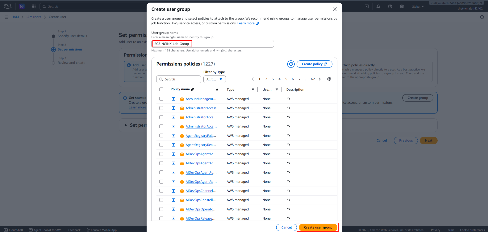


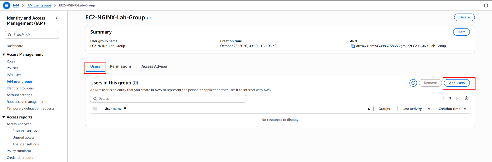


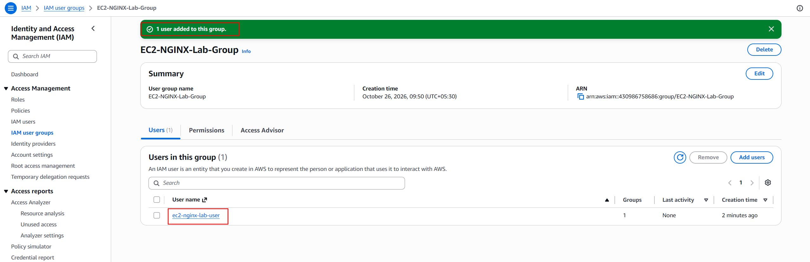

### 5.4 Create and attach the discovery policy

The inline policy is named:

`EC2-NGINX-Lab-Discovery`

Its purpose is to allow selected **read-only discovery operations**. It is not intended to authorize instance creation, security-group modification, key-pair creation, or other deployment changes.

The policy's action list was expanded as additional read-only checks returned `UnauthorizedOperation`. The current intended action list is:

```json
{
  "Version": "2012-10-17",
  "Statement": [
    {
      "Sid": "EC2ReadOnlyDiscovery",
      "Effect": "Allow",
      "Action": [
        "ec2:DescribeAvailabilityZones",
        "ec2:DescribeImages",
        "ec2:DescribeInstanceTypes",
        "ec2:DescribeInstances",
        "ec2:DescribeInternetGateways",
        "ec2:DescribeKeyPairs",
        "ec2:DescribeNetworkAcls",
        "ec2:DescribeRegions",
        "ec2:DescribeRouteTables",
        "ec2:DescribeSecurityGroups",
        "ec2:DescribeSubnets",
        "ec2:DescribeVpcs"
      ],
      "Resource": "*"
    }
  ]
}
```

> This is the policy content intended to reflect the permissions added during discovery. Verify the saved policy in the AWS Console if you need to confirm its current live contents.


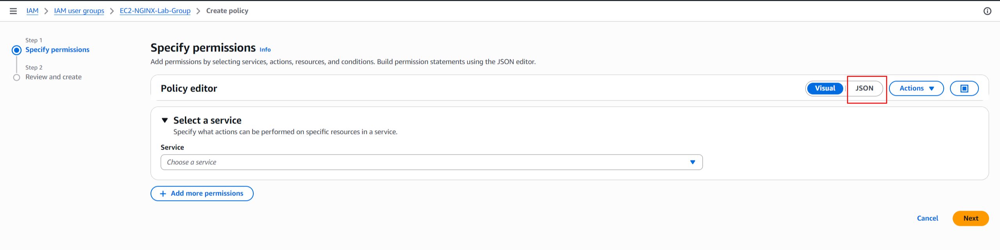


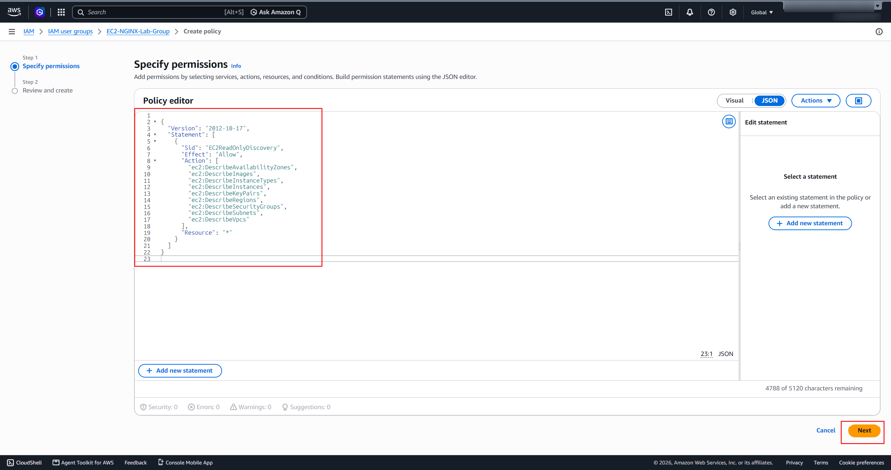

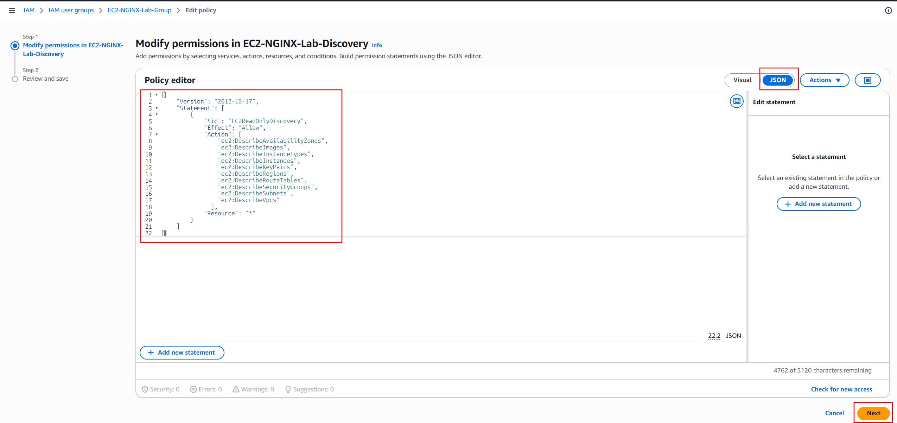


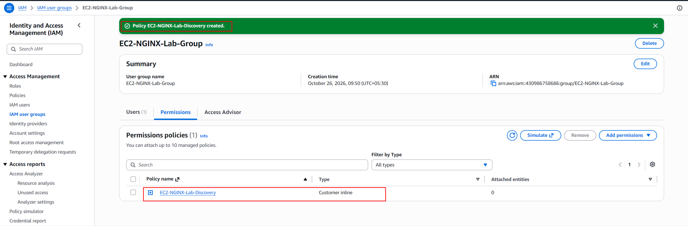

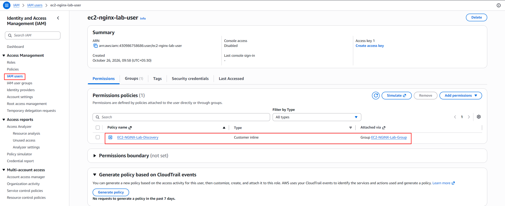

#### Policy explanation

| Policy element | Meaning |
|---|---|
| `Version` | IAM policy language version |
| `Statement` | Contains the permission statement |
| `Sid` | A descriptive identifier for the statement |
| `Effect: Allow` | Allows the listed actions, subject to other applicable policies and restrictions |
| `Action` | Lists the permitted EC2 discovery operations |
| `Resource: "*"` | Uses all-resource scope for these supported describe actions |

The policy is for discovery only. The permissions required to create or modify deployment resources must be planned separately and granted only when needed.

---

## 6. Configure and verify AWS CLI

### 6.1 Configure a named profile

Run in WSL Ubuntu:

```bash
aws configure --profile ec2-nginx-lab
```

Enter the access key and secret access key for the lab identity when prompted. Use the following non-secret configuration values:

```text
Default region name: us-west-2
Default output format: json
```

Do not put actual credential values into this README.

The named profile keeps the lab's configuration separate from the default AWS CLI profile.

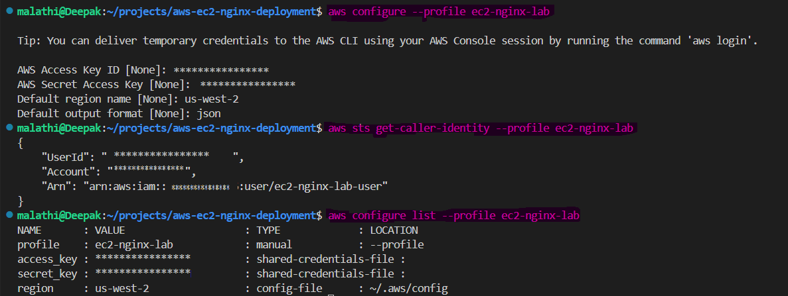

### 6.2 Verify the active AWS identity

Run:

```bash
aws sts get-caller-identity --profile ec2-nginx-lab
```

The command succeeded and identified the caller as the lab IAM user. The account number and user ID are intentionally not reproduced here.

The ARN had this form:

```text
arn:aws:iam::<AWS_ACCOUNT_ID>:user/ec2-nginx-lab-user
```

**Result: Passed.** AWS authentication works with the `ec2-nginx-lab` profile.

### 6.3 Verify profile configuration

Run:

```bash
aws configure list --profile ec2-nginx-lab
```

The observed configuration showed:

- Profile: `ec2-nginx-lab`
- Access key source: shared credentials file
- Secret key source: shared credentials file
- Region: `us-west-2`, read from the AWS CLI configuration file

The credential values should remain masked in any screenshot or shared output.

**Result: Passed.** The expected profile and region were confirmed.

### 6.4 Create access keys securely

The screenshots document the CLI access-key creation flow. Access keys are credentials, not ordinary configuration data. Store them securely, do not commit them to Git, and never include their values in screenshots.

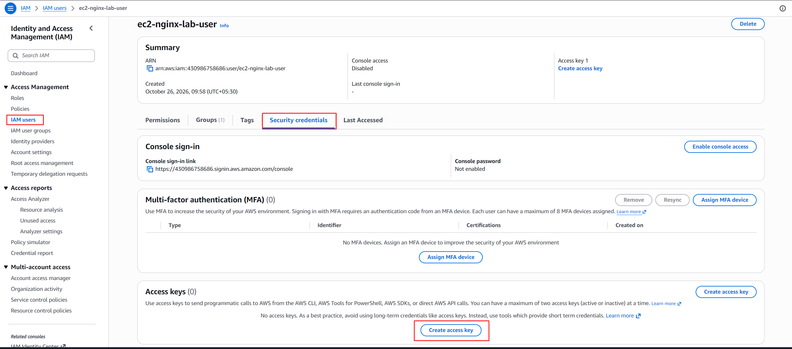

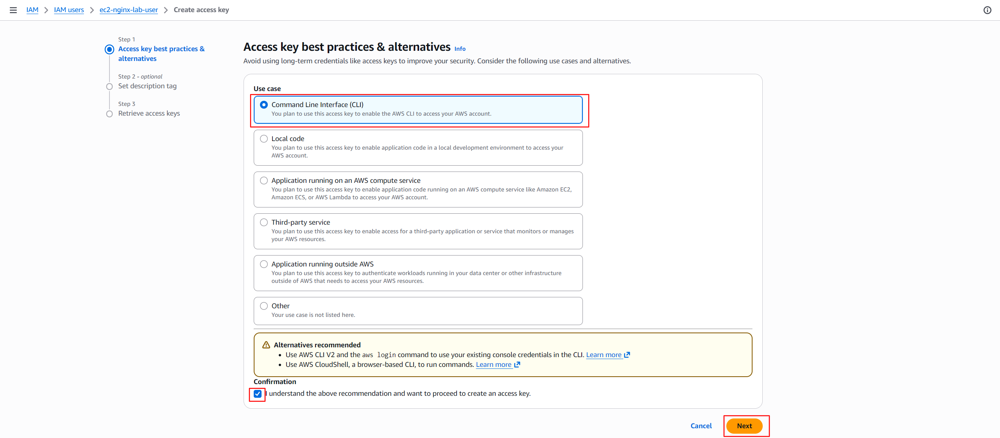


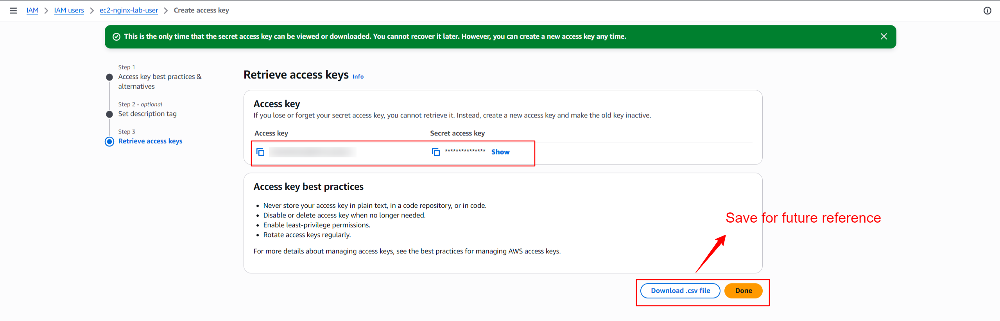


---

## 7. Verify existing EC2 resources

All commands in this section are read-only.

### 7.1 Check existing instances

```bash
aws ec2 describe-instances \
  --region us-west-2 \
  --profile ec2-nginx-lab \
  --output table
```

The command succeeded and returned an empty table—no instances were returned for this identity and region.

**Result: Passed.** The identity can call `ec2:DescribeInstances`; no existing instances were returned by this query.

### 7.2 Check existing key pairs

```bash
aws ec2 describe-key-pairs \
  --region us-west-2 \
  --profile ec2-nginx-lab \
  --output table
```

The command succeeded and returned an empty table—no EC2 key pairs were returned in this region.

**Result: Passed.** The identity can call `ec2:DescribeKeyPairs`. A key pair has not been created for this lab.

---

## 8. Inspect the default VPC and subnets

### 8.1 Discover the VPC

A VPC is a logically isolated network in AWS. EC2 instances launch into a subnet within a VPC.

Run:

```bash
aws ec2 describe-vpcs \
  --region us-west-2 \
  --profile ec2-nginx-lab \
  --query "Vpcs[].{VpcId:VpcId,State:State,IsDefault:IsDefault,CidrBlock:CidrBlock}" \
  --output table
```

The command returned this VPC:

| Field | Observed value |
|---|---|
| VPC ID | `vpc-0307ce67a0df86851` |
| State | `available` |
| Default VPC | `True` |
| IPv4 CIDR | `172.31.0.0/16` |

The CIDR is the VPC's private IPv4 address range; it is not the public IP address of an EC2 instance.

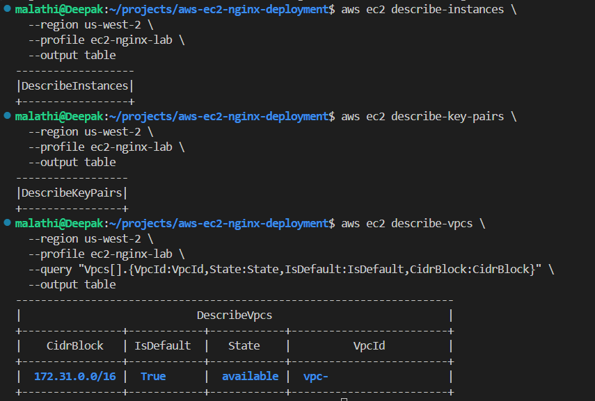

**Result: Passed.** An available default VPC was found. No VPC was created or modified.

### 8.2 Discover subnets

Run:

```bash
aws ec2 describe-subnets \
  --region us-west-2 \
  --profile ec2-nginx-lab \
  --filters "Name=vpc-id,Values=vpc-0307ce67a0df86851" \
  --query "Subnets[].{SubnetId:SubnetId,AZ:AvailabilityZone,State:State,DefaultForAZ:DefaultForAz,PublicIP:MapPublicIpOnLaunch,CIDR:CidrBlock}" \
  --output table
```

Four available default subnets were returned:

| Availability Zone | Subnet ID | CIDR | Default subnet for AZ | Auto-assign public IPv4 |
|---|---|---|---|---|
| `us-west-2a` | `subnet-02ecdd68edfbf7326` | `172.31.32.0/20` | Yes | Yes |
| `us-west-2c` | `subnet-003413e14c2375f32` | `172.31.0.0/20` | Yes | Yes |
| `us-west-2d` | `subnet-0ce894c858eab9c2e` | `172.31.48.0/20` | Yes | Yes |
| `us-west-2b` | `subnet-006fde08c5f4e902c` | `172.31.16.0/20` | Yes | Yes |

`MapPublicIpOnLaunch: True` means the subnet is configured to assign public IPv4 addresses to instances by default, unless overridden at launch. It does not, by itself, guarantee internet connectivity.

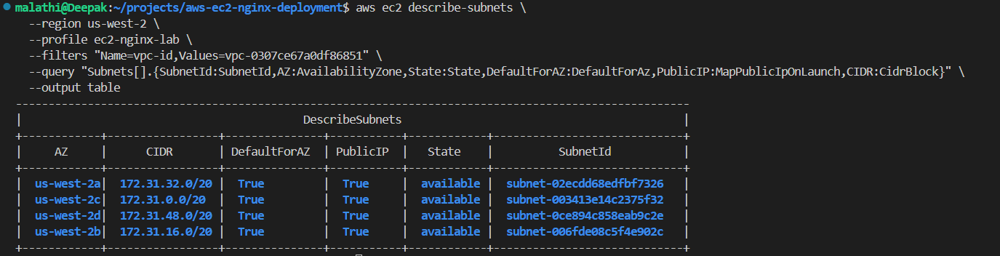

**Result: Passed.** Four available default subnets were discovered. No subnet was created or modified.

### 8.3 Verify the chosen subnet's public-IP setting

For a closer inspection of the subnet in `us-west-2a`, run:

```bash
aws ec2 describe-subnets \
  --region us-west-2 \
  --profile ec2-nginx-lab \
  --subnet-ids subnet-02ecdd68edfbf7326 \
  --query "Subnets[].{SubnetId:SubnetId,AZ:AvailabilityZone,Cidr:CidrBlock,State:State,MapPublicIpOnLaunch:MapPublicIpOnLaunch,VpcId:VpcId}" \
  --output table
```

Observed values:

- Subnet: `subnet-02ecdd68edfbf7326`
- Availability Zone: `us-west-2a`
- CIDR: `172.31.32.0/20`
- State: `available`
- `MapPublicIpOnLaunch`: `True`
- VPC: `vpc-0307ce67a0df86851`

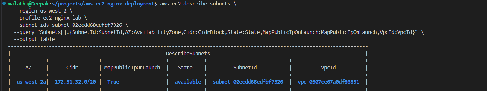

---

## 9. Inspect routing and Internet Gateway

### 9.1 Discover route tables

Run:

```bash
aws ec2 describe-route-tables \
  --region us-west-2 \
  --profile ec2-nginx-lab \
  --filters "Name=vpc-id,Values=vpc-0307ce67a0df86851" \
  --query "RouteTables[].{RouteTableId:RouteTableId,Associations:Associations[].SubnetId,Routes:Routes[].{Destination:DestinationCidrBlock,Gateway:GatewayId,State:State}}" \
  --output json
```

The discovered route table was `rtb-0bc5c0a06e2d2b2c0`. Its routes were:

| Destination | Target | State | Meaning |
|---|---|---|---|
| `172.31.0.0/16` | `local` | `active` | Route for traffic within the VPC |
| `0.0.0.0/0` | `igw-0b25879d76a25f195` | `active` | Default IPv4 route toward the Internet Gateway |

The route table initially showed no explicit subnet associations.

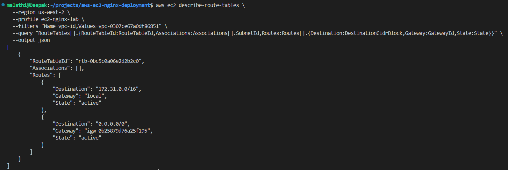

### 9.2 Verify the route table's main association

Run:

```bash
aws ec2 describe-route-tables \
  --region us-west-2 \
  --profile ec2-nginx-lab \
  --route-table-ids rtb-0bc5c0a06e2d2b2c0 \
  --query "RouteTables[].{RouteTableId:RouteTableId,MainAssociations:Associations[?Main==\`true\`].{Main:Main,VpcId:RouteTableId},SubnetAssociations:Associations[?SubnetId!=null].SubnetId}" \
  --output json
```

The result confirmed:

- Route table: `rtb-0bc5c0a06e2d2b2c0`
- `Main: true`
- No explicit subnet associations listed

**Note about the query:** The output key named `VpcId` in this command was mistakenly populated from `RouteTableId`. Therefore, that displayed field is not the VPC ID. The main-association result itself confirms that this is the main route table. The actual VPC ID was independently confirmed as `vpc-0307ce67a0df86851`.

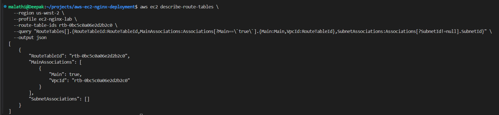

Subnets without explicit route-table associations use the VPC's main route table.

### 9.3 Verify the Internet Gateway attachment

Run:

```bash
aws ec2 describe-internet-gateways \
  --region us-west-2 \
  --profile ec2-nginx-lab \
  --internet-gateway-ids igw-0b25879d76a25f195 \
  --query "InternetGateways[].{InternetGatewayId:InternetGatewayId,Attachments:Attachments[].{VpcId:VpcId,State:State}}" \
  --output json
```

The command confirmed that:

- Internet Gateway: `igw-0b25879d76a25f195`
- Attached VPC: `vpc-0307ce67a0df86851`
- Attachment state: `available`

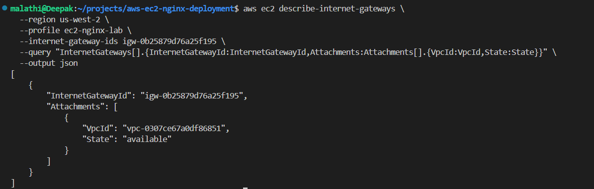

**Networking interpretation:** An active default route and an attached Internet Gateway are important prerequisites for public IPv4 internet routing. They do not alone guarantee that a particular instance will be reachable. Public-IP assignment, security groups, network ACLs, host configuration, and other conditions still apply.

---

## 10. Inspect the network ACL

A network ACL (NACL) is a subnet-level traffic filter. Unlike security groups, network ACLs are **stateless**, so inbound and outbound traffic must be considered separately.

Run:

```bash
aws ec2 describe-network-acls \
  --region us-west-2 \
  --profile ec2-nginx-lab \
  --filters "Name=vpc-id,Values=vpc-0307ce67a0df86851" \
  --query "NetworkAcls[].{NetworkAclId:NetworkAclId,IsDefault:IsDefault,Associations:Associations[].SubnetId,Entries:Entries[].{RuleNumber:RuleNumber,Protocol:Protocol,RuleAction:RuleAction,Egress:Egress,CidrBlock:CidrBlock,PortRange:PortRange}}" \
  --output json
```

The command returned:

- Network ACL: `acl-0d28ab2e0e6e79bf6`
- Default ACL: `true`
- Associated subnets: all four subnets discovered above
- Rule `100`: allow all protocols for IPv4 `0.0.0.0/0`, for both inbound (`Egress: false`) and outbound (`Egress: true`)
- Rule `32767`: deny-all catch-all, for both directions


The rule numbered `100` is evaluated before the catch-all rule `32767`. Since the allow rule matches all IPv4 traffic, the later deny rule does not override it.

**Security note:** `0.0.0.0/0` means all IPv4 addresses. We should not rely on the default NACL to restrict access to the Nginx instance. The instance's security group should allow only the intended inbound traffic.

---

## 11. Check the AMI and instance type

### 11.1 Discover Amazon Linux 2023 AMIs

Run:

```bash
aws ec2 describe-images \
  --region us-west-2 \
  --profile ec2-nginx-lab \
  --owners amazon \
  --filters \
    "Name=name,Values=al2023-ami-2023.*-x86_64" \
    "Name=state,Values=available" \
    "Name=architecture,Values=x86_64" \
    "Name=root-device-type,Values=ebs" \
  --query "Images | sort_by(@, &CreationDate)[-5:].{ImageId:ImageId,Name:Name,CreationDate:CreationDate,Architecture:Architecture}" \
  --output json
```

Five available Amazon Linux 2023 AMIs were returned. Examples from the observed output include:

| AMI ID | Image name | Architecture |
|---|---|---|
| `ami-0e0fcdc77c6355731` | `al2023-ami-2023.12.20261021.0-kernel-6.18-x86_64` | `x86_64` |
| `ami-0ce59d8f4219233f7` | `al2023-ami-2023.12.20261021.0-kernel-6.12-x86_64` | `x86_64` |
| `ami-0f4093d08169978db` | `al2023-ami-2023.12.20261026.1-kernel-6.12-x86_64` | `x86_64` |
| `ami-074462d12abec759f` | `al2023-ami-2023.12.20261026.1-kernel-6.1-x86_64` | `x86_64` |
| `ami-0829b74b2a8c619b7` | `al2023-ami-2023.12.20261026.1-kernel-6.18-x86_64` | `x86_64` |

The image query returned available images owned by Amazon, with x86-64 architecture and EBS root devices. AMI IDs are region-specific, and the latest available image may change over time.

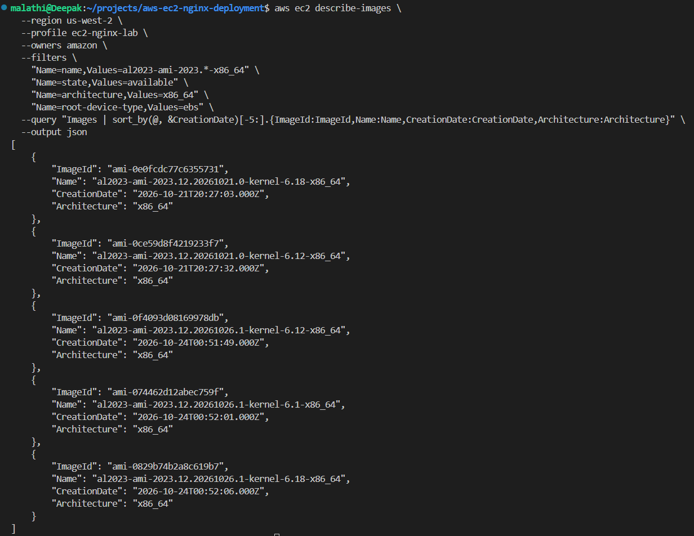

**Status:** AMI discovery succeeded. The final AMI selection should be confirmed again immediately before launching the instance.

### 11.2 Check `t3.micro` specifications

Run:

```bash
aws ec2 describe-instance-types \
  --region us-west-2 \
  --profile ec2-nginx-lab \
  --instance-types t3.micro \
  --query "InstanceTypes[].{InstanceType:InstanceType,Architectures:ProcessorInfo.SupportedArchitectures,vCPUs:VCpuInfo.DefaultVCpus,MemoryMiB:MemoryInfo.SizeInMiB}" \
  --output table
```

The output confirmed:

| Property | Result |
|---|---|
| Instance type | `t3.micro` |
| Architecture | `x86_64` |
| vCPUs | `2` |
| Memory | `1024 MiB` (1 GiB) |

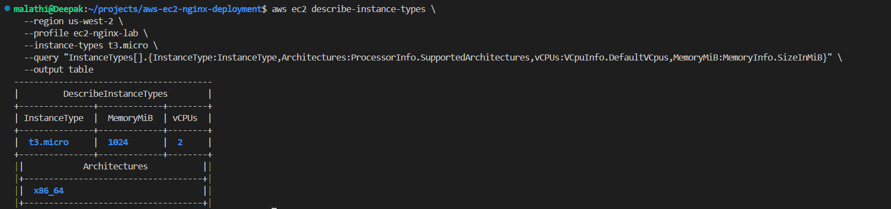

The `x86_64` instance architecture matches the discovered x86-64 AMI candidates.

**Important:** This command confirms the instance type's specifications. It does not confirm account quota, Availability Zone capacity, launch permissions, or cost eligibility. Check current AWS pricing and account eligibility before provisioning; do not assume the instance is free.

---

## 12. Check public-IP behavior

The subnet `subnet-02ecdd68edfbf7326` in `us-west-2a` returned `MapPublicIpOnLaunch: true`.

This setting means automatic public IPv4 assignment is enabled for launches in that subnet unless the launch configuration overrides it. It does not prove that a running application will be reachable.

The network prerequisites to consider together are:

1. The subnet's public-IP assignment behavior.
2. The main route table's default route to the Internet Gateway.
3. The Internet Gateway's attachment to the VPC.
4. Security-group inbound and outbound rules.
5. Network ACL inbound and outbound rules.
6. The instance's operating system and application configuration.

---

## 13. Inspect the existing security group

### 13.1 List security groups in the VPC

Run:

```bash
aws ec2 describe-security-groups \
  --region us-west-2 \
  --profile ec2-nginx-lab \
  --filters "Name=vpc-id,Values=vpc-0307ce67a0df86851" \
  --query "SecurityGroups[].{GroupId:GroupId,GroupName:GroupName,Description:Description,VpcId:VpcId}" \
  --output table
```

Only the default security group was returned:

| Field | Value |
|---|---|
| Group ID | `sg-03b944b8175124bda` |
| Group name | `default` |
| Description | `default VPC security group` |
| VPC | `vpc-0307ce67a0df86851` |

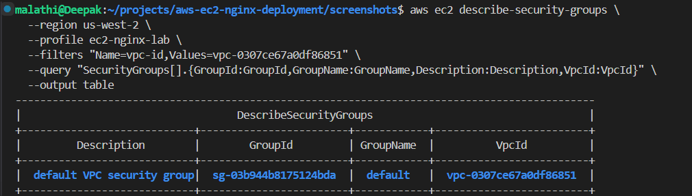

### 13.2 Inspect the default security group's inbound rules

Run:

```bash
aws ec2 describe-security-groups \
  --region us-west-2 \
  --profile ec2-nginx-lab \
  --group-ids sg-03b944b8175124bda \
  --query "SecurityGroups[].{GroupId:GroupId,Inbound:IpPermissions}" \
  --output json
```

The observed inbound rule allowed all protocols from resources associated with the **same security group**. The output did not show an IPv4 CIDR or IPv6 CIDR as an inbound source.

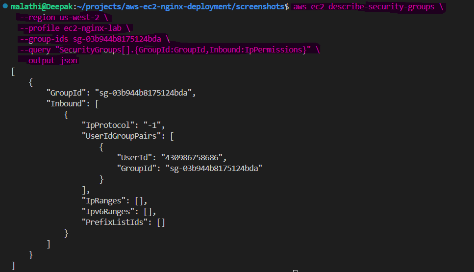

This is not the same as allowing inbound access from the whole internet. The default security group is not the intended public-web access policy for this lab.

### 13.3 Inspect the default security group's outbound rules

Run:

```bash
aws ec2 describe-security-groups \
  --region us-west-2 \
  --profile ec2-nginx-lab \
  --group-ids sg-03b944b8175124bda \
  --query "SecurityGroups[].{GroupId:GroupId,Outbound:IpPermissionsEgress}" \
  --output json
```

The observed outbound rule allowed all protocols to IPv4 destination `0.0.0.0/0`.

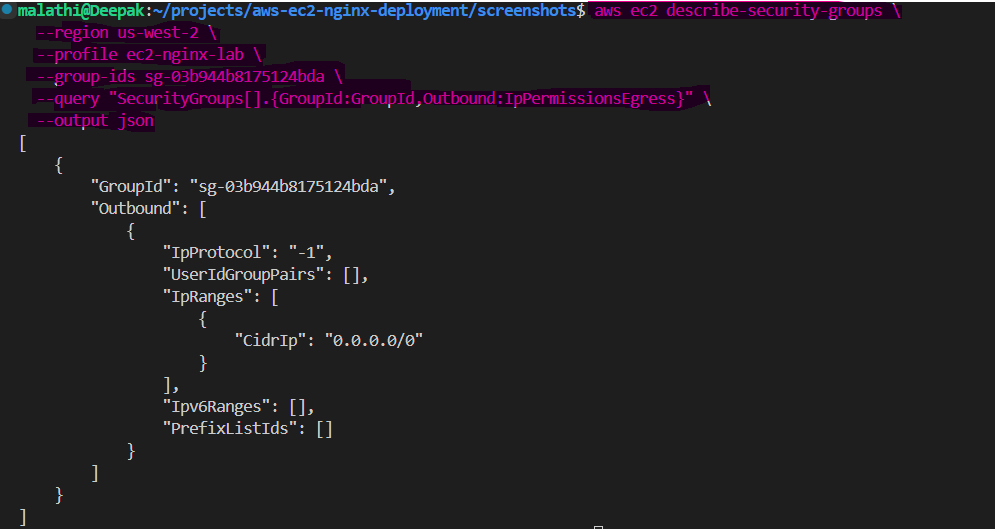

**Important:** An outbound security-group rule is not proof of internet connectivity. Routing, gateway attachment, public addressing, NACLs, and host configuration also matter.

### 13.4 Decide on the lab security group

Before deployment, create or select a **dedicated security group** for the Nginx instance, using an authorized identity and a deliberate inbound policy. A typical public HTTP demonstration needs inbound TCP port `80` from the intended audience. SSH access on TCP port `22`, if needed, should be restricted to the user's trusted IP address or replaced with an appropriate managed access method. HTTPS on TCP port `443` should be opened only if TLS is configured for the lab.

Do not use a broad inbound rule such as all protocols from `0.0.0.0/0`.

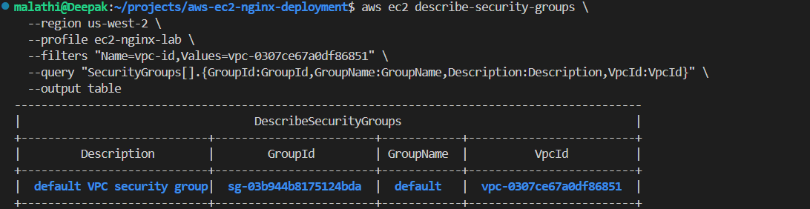

---

## 14. Verified findings

| Check | Result |
|---|---|
| AWS CLI named profile | `ec2-nginx-lab` configured |
| AWS identity | Verified with STS |
| Region | `us-west-2` |
| Existing EC2 instances | None returned |
| Existing EC2 key pairs | None returned |
| Default VPC | Available |
| VPC ID | `vpc-0307ce67a0df86851` |
| VPC CIDR | `172.31.0.0/16` |
| Default subnets | Four available across four Availability Zones |
| Main route table | `rtb-0bc5c0a06e2d2b2c0` |
| Default IPv4 route | Active route to `igw-0b25879d76a25f195` |
| Internet Gateway | Attached to the VPC, state `available` |
| Network ACL | Default ACL; allow-all IPv4 entries in both directions |
| AMI discovery | Amazon Linux 2023 x86-64 candidates found |
| Instance type specs | `t3.micro`, x86-64, 2 vCPUs, 1 GiB |
| Public-IP default | Enabled on the inspected subnet |
| Existing security groups | Only default security group returned |
| EC2 instance launched | **No** |
| NGINX installed | **No** |
| Web application deployed | **No** |

## 15. Pending work

The next steps are still pending. Continue one step at a time and verify each prerequisite before creating resources.

- [ ] Confirm the saved discovery policy contains all the required `Describe*` actions.
- [ ] Confirm launch permissions with an appropriately authorized identity.
- [ ] Decide on secure SSH/management access.
- [ ] Decide whether to use a dedicated security group and finalize inbound rules.
- [ ] Reconfirm the selected AMI immediately before launch.
- [ ] Review instance quota, Availability Zone capacity, and current AWS pricing.
- [ ] Review storage settings and expected charges.
- [ ] Launch the EC2 instance only after explicit readiness review.
- [ ] Verify instance state, public IP, and access.
- [ ] Install NGINX.
- [ ] Deploy or configure a basic web page.
- [ ] Verify the website from a browser and with command-line checks.
- [ ] Record troubleshooting steps and evidence.
- [ ] Clean up resources at the end of the lab.

## 16. Security and cost notes

- Never commit AWS credentials or private SSH keys.
- Use least-privilege IAM permissions.
- The discovery policy is not a deployment policy.
- Avoid inbound SSH access from `0.0.0.0/0`.
- Permit only required inbound web traffic.
- Review charges for EC2 runtime, EBS storage, public IPv4 addresses, data transfer, and any additional resources.
- Do not assume that `t3.micro` is free; verify current account eligibility and pricing.
- Before terminating resources, preserve any evidence or files needed for the project.
- When finished, verify that billable resources have been stopped or deleted as intended.

## 17. Troubleshooting notes

### `UnauthorizedOperation`

Example:

```text
You are not authorized to perform: ec2:DescribeNetworkAcls
```

**Meaning:** The IAM identity does not have an applicable allow for the requested action, or another policy restriction applies.

**Resolution used in this lab:** Add the specific missing read-only `ec2:Describe...` action to the existing discovery policy, if authorized, then retry the same read-only command. If you cannot edit IAM policies, request help from an authorized administrator. Do not grant yourself broader permissions to bypass the error.

### Empty output from `describe-instances` or `describe-key-pairs`

An empty result can mean no matching resources were returned for the identity and Region. It is not, by itself, evidence of an error.

### An Internet Gateway route does not guarantee reachability

Check public-IP assignment, the route table, gateway attachment, security groups, NACLs, host firewall, and whether the service is listening on the intended port.

---

## Current project status

**AWS access and read-only network discovery have progressed successfully.** The default VPC, subnets, main route table, Internet Gateway attachment, default network ACL, Amazon Linux 2023 AMI candidates, `t3.micro` specifications, subnet public-IP setting, and default security group have been inspected.

The environment is **not yet ready for an instance launch** until the remaining IAM, secure access, security-group, quota, and cost checks are completed.

**No EC2 instance or NGINX web application has been deployed.**
